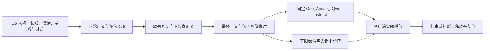

# 苏沐薇逐句表达：语音与皮套接入记录

日期：2026-10-04。授权：用户「行，按照你的方案建设」。方案来源：[GitHub 复用调研](../research/Post-Lv2-Expressive-Intent-GitHub-Reuse-2026-10-04.md)。

> ⏩ **2026-10-07 修订（只追加，下文一字不改）**：本记录里的 TTS 是 **Qwen3-TTS-12Hz-1.7B-CustomVoice**（现在的 `legacy` 档）。
> **当前生产档是 CosyVoice3**：`scripts/postlv2-avatar.cmd:6` 的缺省是 `POSTLV2_SPEECH_PROFILE=cosyvoice3`，
> 只有显式设 `legacy` 才切到 `qwen3-tts-venv`；按句流式与浏览器播放的读数按 CosyVoice 记在
> [Checked-Sentence-Streaming-2026-10-05.md](Checked-Sentence-Streaming-2026-10-05.md)。
> ⚠️ 两个 venv **隐式耦合**：`cosyvoice3-venv` 的 `speech-base.pth` 把 `qwen3-tts-venv\Lib\site-packages` 加进路径
> （`torch` / `flash-attn` 在那边）⇒ **删掉 legacy 档会打坏默认档**。
> 另：本记录写于**表达开关尚未进 `flags.ts`** 的时期，`CHARACTER_EXPRESSIVE_SPEECH` 至今仍是三处裸 `process.env`
> 读取、且 `.env` 未设（生产未激活）——见 [docs/audit/2026-10-07-full-project-audit.md](../audit/2026-10-07-full-project-audit.md) §3/§4/§11。
>
> ⏩ **2026-10-07 第二次修订（只追加）**：上面那段里的"仍是三处裸 `process.env`"**已不成立** ——
> 开关已收进 `src/kernel/app/flags.ts` 的 `expressiveSpeechEnabled`（缺省 `false`），
> `main.ts` 的三处消费点改为读 flags（`:4073` / `:4189` / `:4247`），诊断行新增 `record('expressive-speech', …)`。
> ⚠️ **语义放宽一处**（如实登记）：旧裸读只认小写逐字 `'true'`；现在 `1/true/yes/on`（大小写不敏感）都算开，
> 其余字符串回落缺省 `false` ⇒ 生产行为不变（`.env` 未设），但 `=TRUE` 的含义变了。
> ⚠️ **生产仍未激活**，本记录的读数与结论不受这次改动影响。

## 已实现的行为

LG 在同一次回复生成中决定说话正文和每句表达意图；正文经过既有五道回复守卫后，程序将最终文本、replyId、segmentId 与表达元数据绑定。外壳将这些元数据送到 Ono_Anna 和 Live2D 执行端。皮套动作从实际音频播放时开始，结束、打断、失败或断线时释放。



内在情绪与外在表达分别处理。她可以心情低落而决定安慰你；表情不直接从 Affect 的正负值推断。任务的听取、生成、失败、打断仍由程序事实决定。

| LG 表达意图 | Qwen 语气请求 | 面部资源 | 小动作 |
|---|---|---|---|
| natural | 自然日常，平稳、不夸张 | neutral | 无 |
| reassuring | 温柔安慰，柔和克制 | smile | 小幅点头 |
| playful | 轻松俏皮，有一点笑意 | smile | 小幅偏头 |
| firm | 坚定、沉稳，语速自然 | neutral | 无 |
| subdued | 收敛、稍缓，平静表达低落 | neutral | 无 |
| surprised | 短暂惊讶，避免尖叫 | surprised | 无 |

声线固定为 **Ono_Anna**；语气指令是模型请求，听感需要真人确认。当前皮套没有 motion3 动作资源，点头与偏头使用已存在的 ParamAngleY / ParamAngleZ：最大请求分别为 3 / 4 度，分别持续 1.4 / 1.8 秒，每句执行一次，并夹紧到模型原生参数范围。渲染前叠加、渲染后还原该参数的基线，不写眼睛、嘴部或衣装参数。

## 协议及执行边界

- 新增可选 `expressive-speech` ContextCompiler section 和 `lg-expression@1` 表达旁路；保留唯一 SPEECH 输出，不新增认知、记忆或外部行动权限。
- LG 使用完整保留封套 `<lg-speech>{"segments":[{"text":"你好。","cue":"natural"}]}</lg-speech>`。只解码完整封套，不清理正文中的通用方括号标签。
- 未提供表达封套时保留原正文并使用 natural；未知 cue 回退 natural；格式损坏的保留封套拒绝转成说话正文。
- **守卫改写任何正文时，整轮表达回退 natural**，并记录 `guard_rewrite`，避免旧表达绑定到改写后的句子。
- 桥和语音适配器检查句子拼接与已检查正文一致，校验句子身份及 SHA-256；每个合成任务单独携带元数据，避免排队时语气串线。
- 客户端使用 generation、segmentId 和已播放集合拒绝旧片段、重复片段及未登记表情；禁止换装、任意参数名和模型输出文件路径。
- 表情和小动作在音频元素的 `playing` 事件执行，排队或收到音频包不算播放。结束后回到 neutral；打断即停止音频并释放动作。断线释放，重连重新开始 generation。
- **已进入原生 GPU 推理的工作不能立即抢占停止**。打断可以立即停止播放；晚到的音频不再发送/播放，临时文件在推理返回后清理。新的合成任务可能仍需等待当前 GPU 工作结束。

`/lg/status` 只读回身份、摘要、cue、固定语气指令和合成耗时，不输出正文或 prompt。当前 bridge 的 `guardStates` 在这个端点为 null；本记录不将它宣称为真实轮的守卫状态读回，守卫链通过源码接线及离线真实策略测试验证。

## 本机使用及版本

```powershell
pnpm postlv2:avatar
# 当前已运行：http://127.0.0.1:12393
```

此入口开启表达模式，使用真实库的 **sandbox-copy**；测试对话不写回她的真实记忆。普通生产入口默认关闭 `CHARACTER_EXPRESSIVE_SPEECH`，本次未追加生产 `.env` 或执行真实库迁移。现有真实库的版本若由其他会话变化，不属于本次表达接入的迁移或验收。

额外安装的是与既有前端包对应的源码与构建依赖，已经准备好：无需你再下载 TTS 模型、皮套动作包或另一个人格后端。

| 组件 | 固定版本 |
|---|---|
| Open-LLM-VTuber 后端 | `992309c0aa19845960228f880013d4685fde93b5` |
| 原前端包子模块 | `06a659b114fff788cf0daaa86e484576db4975bf` |
| 前端对应源码 | `3d57a9a0125a0ca13e5d096f7092e4e494ed389e` |
| Qwen SDK / 权重 | `qwen-tts 0.1.1` / Qwen3-TTS-12Hz-1.7B-CustomVoice |
| 当前推理实现 | BF16 / SDPA / Ono_Anna |

安装脚本按固定源码重建四个上游文件的局部补丁，加上本仓库的播放执行器，使用上游 lockfile 构建 browser renderer。外部 checkout 的原提交身份保留，修改后的 bundle 是本地管理的构建结果；补丁及 index 指纹见 [前端构建回执](../../artifacts/post-lv2/expression-integration-20261004/frontend-build.json)。

直接复用 Open-LLM-VTuber 的句子/音频载荷与 Qwen instruct。AITuberOnAir、AIRI 提供生命周期及参数复位设计参考；执行器为本仓库实现，未引入它们的完整应用或复制源码正文。软件许可、Cubism SDK、模型权重及 BOOTH 素材的许可分别适用，原外部许可证保留。

## 验证读数

| 验证项 | 当前结果与证据范围 |
|---|---|
| `pnpm postlv2:expression:verify` | PASS：TS 16/16、Python 11/11。真实守卫、真实 bridge wire、实际适配器与上游 TTS 队列；声学模型及 Cubism 对象在此门内使用 stub，无 GPU |
| `pnpm typecheck` | PASS：LG 仓库，包括新增脚本 |
| `pnpm m3.5:baseline:check` | PASS：默认关闭时原 prompt 基线保持一致 |
| bridge / body / delivery / avatar 专项门 | PASS：既有对接、任务状态、交付阶段与 36 个表情登记仍有效 |
| `pnpm m4.5:ci` | **FAIL / EXIT 1**：M3.5 测试 29/1，失败项为 FC-T04 故事模块边界；具体路径和原始日志摘要已保留 |
| 完整回归停止点之后的剩余 17 个命令 | 全部 EXIT 0；不覆盖完整 CI 的 FAIL，也不构成完整回归放行 |
| `pnpm m4.5:gates` 当前硬门 | G12/G13 PASS，G14 **FAIL 26/18**（读取既有 L4 档，本轮未重跑）；聚合命令 EXIT 0 不代表硬门 PASS |
| 前端 `npm run build:web` | PASS：本机 bundle 已构建并加载到实际浏览器 |
| 上游前端全量 typecheck | FAIL：原始源码与补丁版本各 586 项既有诊断；不能据 browser build 宣称全量类型通过 |
| 实际客户端与 GPU 冒烟 | PASS：安慰/点头、俏皮/偏头、同轮安慰→坚定、打断及新一轮恢复；身份/文本摘要对账 |
| 最终修订后的真实链 | PASS：firm 指令已实际入合成，客户端 playing→ended；另一轮真实守卫改写触发 natural / guard_rewrite |
| 同句不同语气的 GPU 耗时对照 | EXECUTED：原始映射 7 档各 2 次；发现 firm 退化，修订后的 firm 另跑 3 次，原始异常读数保留 |
| 真人盲听、主观情绪/动作及实时体验 | NOT RUN：按用户安排，在工程完成后由用户进行 |

真实同轮测试中 LG 选择 `reassuring, firm, firm`，客户端逐段报告 playing→ended，点头渲染叠加峰值约 2.31 度；俏皮测试实际执行了 tilt。真实打断后客户端 active=null、当前 generation 被撤销，后续恢复轮只播放新的 generation，旧轮的剩余段未再播放。

**完整回归未通过，不能据此宣布整库验收通过。** FC-T04 的失败路径为 `src/content/storyline/jichuang-interview-two/story-pack.ts`、`src/infrastructure/runtime/story-cognition.ts`、`src/main.ts` 的直接 storyline 引用。这些引用来自另一条 S8 建设线，超出 ADR-091 登记的目录；本轮未扩大白名单、改判据或回退它们。表达新增模块不包含 storyline 引用。M4.5 的 G14 则是既有红色 Live Smoke 档，本轮仍如实列红。

恢复轮的短句合成 3.85 秒，音频约 1.92 秒；这是单轮实际观察，不是性能验收或稳定实时结论。现有后端仍采用整句非流式合成，表达接入不消除这项等待。

### 真实 GPU 对照与修订

固定输入「既然你来了，那就陪我说两句话吧。」，Ono_Anna / BF16 / SDPA，预热 1 次，每个样本重置 seed=20261004，第二轮反转测试顺序。生成前本机 GPU 利用率约 2%，停止服务后单独加载测试模型，没有同时运行第二个 TTS 实例。以下是小样本观察，**性能验收 = NOT ACCEPTED**；语气指令可能同时改变音频长度，不能只比较绝对合成秒数。

| 条件 | 平均合成秒数 | 音频秒数 | 试听样本 |
|---|---:|---:|---|
| 原版空 instruct | 9.26 | 4.56 | [空指令对照](../../artifacts/post-lv2/expression-integration-20261004/voice-samples/legacy_empty-1.wav) |
| natural | 7.05 | 3.44 | [自然](../../artifacts/post-lv2/expression-integration-20261004/voice-samples/natural-1.wav) |
| reassuring | 8.94 | 4.48 | [安慰](../../artifacts/post-lv2/expression-integration-20261004/voice-samples/reassuring-1.wav) |
| playful | 7.95 | 3.92 | [俏皮](../../artifacts/post-lv2/expression-integration-20261004/voice-samples/playful-1.wav) |
| firm 原指令（异常） | 42.78 | 21.04 | 原始文件保留用于诊断，不作为交付试听样本 |
| subdued | 9.73 | 4.80 | [收敛](../../artifacts/post-lv2/expression-integration-20261004/voice-samples/subdued-1.wav) |
| surprised | 11.65 | 5.68 | [惊讶](../../artifacts/post-lv2/expression-integration-20261004/voice-samples/surprised-1.wav) |
| firm 修订指令，同句 seed=20261004 | 7.21（1次） | 3.60 | [坚定，修订版](../../artifacts/post-lv2/expression-integration-20261004/voice-samples/firm-repair-1.wav) |

原 firm 指令「语气坚定而克制，保持正常音量，不喊叫。」在两次相同 seed 下生成逐字节相同的异常长音频，本机 CPU ASR 读回与输入明显不符。只把指令改成「语气坚定、沉稳，语速自然。」，模型、speaker、文本、seed 和生成参数保持相同，音频恢复 3.6 秒；追加另一 seed 和另一句子，三次修订探针的音频为 3.52–4.8 秒、合成为 7.21–10.29 秒，未再复现该异常。工程映射已采用简化指令，提交 `371de1cf`。

这支持「语气指令与本次退化相关」的局部归因，不证明已消除模型的全部漏字、赘词或声学错误。ASR 有识别误差，读回不能代替真人听审。原始七档数据见 [GPU 对照](../../artifacts/post-lv2/expression-integration-20261004/gpu-voice-comparison.json)；修订三次见 [firm 探针](../../artifacts/post-lv2/expression-integration-20261004/firm-instruction-probe.json)。原始对照使用 `e451a38c` 当时的映射，审计脚本副本依赖该版本，不是当前六档映射的全量复测。

本批音频的合成速度约为音频时长的 2 倍，尚未达到实时合成。修订后又跑 `postlv2:expression:verify` 27/27 与 LG typecheck，通过；不重写先前整库回归的 FAIL。

最终服务的真实 firm 短句合成 4.28 秒、音频 1.76 秒，语气指令确为修订版，句子摘要与桥返回一致，客户端正常完成播放。此前一次「约定」测试触发既有回复守卫改写，整轮两句均回退 natural，并读回 `expression_fallback=guard_rewrite`；这是真实链的回退观察，未将它算成 firm 测试通过。

最终页面保留在 Codex 浏览器，服务已后台启动，状态为 sandbox-copy / lg_process_alive=true。本机本轮后台 PID 31904，运行记录在 `%LOCALAPPDATA%\Temp\lg-avatar-expression-final-20261004`；后续重新启动时 PID 会变化。

证据总目录：[expression-integration-20261004](../../artifacts/post-lv2/expression-integration-20261004/)。保留测试失败、原始上游类型诊断和不同阶段的读数；以最终 receipt 所列指纹识别交付版本。


## 交付文件与提交归属

- 表达契约：[expressive-speech.ts](../../src/kernel/contracts/expressive-speech.ts)；编译指令：[expressive-speech-section.ts](../../src/kernel/context/expressive-speech-section.ts)。
- 有限映射：[postlv2_expression.py](../../scripts/postlv2_expression.py)；播放执行器：[postlv2_expression_client.js](../../scripts/postlv2_expression_client.js)。
- 前端补丁构建：[postlv2-expression-frontend.py](../../scripts/postlv2-expression-frontend.py)；现有适配器：[postlv2_vtuber_runtime.py](../../scripts/postlv2_vtuber_runtime.py)。
- 专项门：[TS](../../scripts/postlv2-expression-verify.ts) / [Python](../../scripts/postlv2-expression-verify.py)。

核心旁路提交 `99a4d0a8`；执行端提交 `c4cce5c3`；专项门提交 `0a0c50c2`。共享 `src/main.ts` 的本次解码、守卫和绑定接线已被另一会话的整文件提交 `c7738ed7` 带入，新增叶模块在本轮按路径补齐提交；本轮未将该提交中的 S8 改动算入表达成果。

安装缓存指纹核对追加提交 `e451a38c`，并实跑配置脚本确认重复启动可以复用已核对的前端 bundle。
