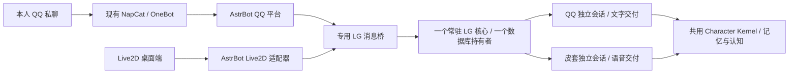

# QQ 与 Live2D 双入口执行计划

日期：2026-10-06（UTC+8）。状态：**计划已准备，实施尚未开始，生产尚未切换**。

目标：QQ 与 Live2D 可以同时在线聊天，近期上下文、回复投递、播放和取消分别归属各自入口；继续使用同一个苏沐薇人格、Alex 身份与 LG 记忆/认知核心。优先验证现成组合，依据是[现成方案核对](QQ-Live2D-Coexistence-OSS-Review-2026-10-06.md)。

## 1. 第一版范围与成功标准

| 对象 | 第一版处理 | 验收方式 |
|---|---|---|
| 人格、用户身份、长期记忆、信念、关系、情绪、目标 | 共用既有 LG 权威状态 | 两路 characterId / userId 相同；记忆仍走原证据、校验、提交和召回链 |
| 近期对话、摘要、当前任务上下文 | 按入口分开 | 用两路唯一标记检查实际 ContextPacket 的 Recent 与会话摘要区块，以及任务上下文；另一入口原文不得混入这些区块 |
| 回复、文字片段、表情、音频 | 只发回原入口 | 核对真实接收方与 requestId / replyId / segmentId；QQ 内容不自动在皮套播放 |
| 取消、打断、断开、重连 | 只作用于所属入口 | 打断皮套不取消 QQ；关闭一个客户端不关闭 LG 核心或另一入口 |
| 正式轮次 | 首版有序处理，两路公平排队 | 两路可同时接收输入；同入口保持顺序；控制消息不被慢轮次阻塞 |
| 合成、播放 | 与正式轮次队列分离 | 皮套上一轮还在播放时，QQ 能继续完成文字轮次；播放仍如实回报 |

“互不影响”在本计划中指对话和交付不串台。共享记忆意味着 QQ 明确记住的事实可在皮套召回；共享情绪、关系和目标也会跨入口生效。共同的模型额度、核心进程和有序轮次队列仍会造成资源关联，第一版不承诺两个模型请求完全同时运行或零等待。

这版继续采用本人私聊、独立机器人号与现有白名单。群聊、主动发消息、多用户、任意自选角色/会话、额外桌面自动化均不扩展。

## 2. 优先路线与采用条件

第一候选：本机已有 AstrBot 部署，加上 lxfight 的 Live2D 适配器与桌面端。AstrBot 负责平台接入和交付，LG 负责所有角色回答、记忆、认知与已登记行动。

建议的最小接线：专用 AstrBot–LG 消息桥复用现有 stdio 协议，管理一个常驻 LG 子进程；LG 进程内按两个受信入口装配会话。先验证这种方式是否足够，不同时建设通用 OpenAI 代理或任意会话路由服务。

源码核对表明这个组合有分平台会话与定向回传机制；与 LG 的完整兼容尚未运行验证。WP1 若发现必须重写前端音频调度、建立第二份人格/记忆权威，或无法保留当前已用语音行为，就不采用整套替换路线，转用**本机现有 NapCat + Open-LLM-VTuber，共用 LG 核心**。失败证据保留，计划追加实际采用路线。

备用路线仍优先复用现有皮套、ASR/TTS、QQ 适配器和桥协议，只补单持有核心的连接与入口隔离；连接方式在 WP1 按已有依赖确定。两条路线选择一条实施，不同时长期维护两套新框架。

## 3. 候选版本与基线

| 组件 | 优先验证对象 | 已知边界 |
|---|---|---|
| AstrBot | 本机部署中固定的镜像 digest，README 记录为 4.27.5 | 另存源码为 4.28.0-beta.1、Python >=3.12；不能把源码与实际镜像当作同一版本 |
| Live2D 适配器 | [v1.3.1](https://github.com/lxfight/astrbot_plugin_live2d_adapter/releases/tag/v1.3.1)，提交 `08a35c3c0ec42f05eccd96eb1ec25955d1e05386` | MIT；依赖 websockets、aiohttp、aiofiles；须核对该 release 的实际路由和依赖 |
| Live2D 桌面端 | [v1.6.0](https://github.com/lxfight/astrbot-live2d-desktop/releases/tag/v1.6.0)，提交 `de15e1e9793da0afd7fcb21152913531de974b31` | MIT；Windows 包、Cubism Core、当前模型与语音协议分别验收 |
| 现有皮套备用 | 本机 Open-LLM-VTuber 的已核对提交 `992309c` 与 LG 适配层 | 保留现有 ASR/TTS、已检查语句、播放账与取消流程 |

以上 tag 已在计划编写时通过 GitHub ref 解析为 commit。上一份核对记录检查的是更新后的分支提交，**不等于上述 release 的源码**；WP1 必须重查本表精确版本。依赖和资产摘要在执行时落清单，镜像不自动换成 latest。AstrBot 本体为 AGPL-3.0；桌宠和适配器的 MIT 不覆盖 Cubism Core 与模型素材许可。

## 4. 工作包、交付与退出条件

| 工作包 | 实施内容 | 交付与通过条件 |
|---|---|---|
| WP0：基线与设计 | 核对实际镜像、模型、ASR/TTS、入口开关；梳理 ChatSession 生命周期、后台消费者、水位、幂等、历史与摘要作用域；追加设计 ADR | 形成版本/配置基线和作用域表；明确一个核心、两个会话、一个后台消费权威及回滚；ADR 编号执行时按仓库现状分配 |
| WP1：现成组合兼容试验 | 在隔离部署中加载固定版本插件与桌面端；用模拟 OneBot 和受控回复检查平台事件、定向投递、模型导入、语音、打断和退出 | 产出兼容矩阵；每项标明通过/失败/不适用/未运行；决定采用 AstrBot 路线或现有皮套备用路线 |
| WP2：共享核心与文字双入口 | 一次初始化数据库和公共消费者；受信装配两个会话；公平有序调度；回复和取消按入口归属；接入共用语义写入与召回 | 两路同时输入可各自完成；ContextPacket、事件、trace、记忆实际读回；一个入口失败后另一路新请求成功 |
| WP3：皮套媒体与控制 | 复用当前 ASR/TTS，映射已检查语句、表情、合成与播放回报；客户端断开只清理自身资源；核心退出走原关闭链 | QQ 只收文字，皮套只播自己的片段；打断/断线/晚到回报不影响 QQ；播放事实与已提交事实分开报告 |
| WP4：隔离整链与回归 | 执行下文场景矩阵、真实模型有限检查、人工体验及相关回归；记录双入口延迟与排队影响 | 硬隔离场景全部通过；真实模型、真人体验、性能读数分别给结论；完整离线 CI 退出码 0；失败档保留 |
| WP5：上线准备与切换 | 写启动、停机、回滚脚本和激活候选；冻结测试源指纹；在生产切换获准后正常关闭旧 QQ，再启动共用核心与两入口 | 配置、版本、账号鉴权、单持有、后台消费者和正常关闭读回；由本人自然聊天验证真实往返；首用未观察则如实保留 |

依赖顺序：WP0 → WP1 → WP2 → WP3 → WP4 → WP5。WP1 不通过时先完成备用路线裁定和范围修订，再继续 WP2。每个包交付证据和当前限制，不把安装成功当成并存成功。

### WP0 / WP2 的关键实现约束

- **会话由程序绑定。** 前端认证与 QQ 白名单确定入口、用户和角色；外部昵称、persona、conversationId、消息角色字段不能切换身份或绕过网关。输入数据始终作为用户消息处理。
- **只共享公共状态。** 近期对话、摘要缓存、准备轮次、任务内容、请求表、取消表和播放账必须逐项确认入口作用域；不能只改 conversationId 后宣布隔离。
- **公共生命周期只运行一次。** 不直接给两个 ChatSession 各调用整套 open/close 后便认为完成；Affect、Relationship、Belief、Reflection、Agreement、Story 等消费者的恢复、tick、水位和收尾均须有单一管理者，防止重复消费或一路关闭导致另一路失效。
- **审计事件坐标。** 会话序号各自推进；共享消费者的排序、水位和幂等坐标不得误把不同会话的相同 sequence 当成同一事件。优先沿用现有账本/schema；若其契约不支持这种用法，先提出独立设计修订与迁移评估。
- **首版有序而不等待播放。** 正式轮次先有序处理；两路队列有界、轮转公平，避免一边连续消息饿死另一边；取消/播放回报走控制通道。音频播放不持有正式轮次锁。后台队列等待不能超过入口等待期限却被误报成模型超时。
- **断开不是停机。** 客户端 close 只关闭该连接；只有核心管理者能排空两路、等待在飞消费者、关闭库并释放租约。
- **保留回复与动作真相。** 不用 AstrBot 默认 Agent、另一模型或独立记忆组件回答 LG 失败请求；AstrBot 的额外表演规划也不改写 LG 已检查的角色文字和认知结果。工具执行仍走 LG 的 ActionRequest → Policy/Gateway → Adapter → ActionResult 链。

### 历史与记忆的切换规则

建议两个新入口各从新的近期会话开始；旧混合历史保留原记录和查询入口，不把旧混合原文复制到两个新会话。CLI 原会话语义保持原样。

共享长期记忆、语义索引、关系和认知状态继续使用现有 owner / character，不重建人物、不重新播种 origin/cutover、不把旧记忆重复导入。切换会重建近期上下文，并不删除已存记忆。语义写入仍采用 [ADR-108](../adr/ADR-108-semantic-memory-write-activation.md) 的“明确记忆操作 + 原校验链”，不会改成自动记录全部闲聊。

## 5. 验收场景与证据

| 场景 | 必须观察到的结果 |
|---|---|
| 同时提交 QQ 与皮套文字；两边使用相同外部 requestId | 程序绑定的内部请求互不冲突；回复各回原入口；每个会话序号连续 |
| QQ 输入标记 A、皮套输入标记 B，再分别追问 | 两份实际近期上下文和摘要分别归属；另一入口标记不因近期窗口混入 |
| QQ 明确“请记住”后，皮套询问该事实；反向重复 | 原语义写入链提交一次；另一入口经共享记忆召回；证据引用仍指向原入口事件 |
| 两路普通闲聊、问句、引用记忆命令、否定命令 | 延续现有明确意图与内容边界；不能因路由或框架包装而增加自动写入 |
| 皮套正在播放时收到 QQ；QQ 长轮次期间取消皮套排队请求 | QQ 不被播放占住；取消仅影响所属请求；已提交轮次如实报告不能撤销 |
| 桌面断开、QQ 连接断开、单路超时、单路发送失败 | 核心保留；另一路的新请求恢复成功；不自动重发结果不明的 QQ 消息 |
| 同进程断线重连与重复 OneBot 事件 | 复用现有有界去重和回声抑制；不双重处理已命中去重窗口的事件；重启后的再投递边界单独登记 |
| 伪造入口、用户、角色、会话、播放对象和取消对象 | 拒绝或丢弃；零越权落账、零错发、零跨入口取消 |
| 慢模型、慢语义抽取、队列上限、连续多条 QQ | 两路有界排队、公平完成或如实拒绝；控制消息可达；记录排队和模型耗时 |
| 坏 JSON、坏语义标签、模型失败后同进程新请求 | 失败不伪报记忆/交付成功；后续请求能够恢复 |
| 稳定运行后正常重启 | 共享状态一致；两路分别恢复会话；消费者水位、身份映射、租约和关闭状态对账 |
| 用户观察皮套语音与表情，同时操作 QQ | 在隔离环境核对实际体验：字幕、音频、表情、打断、麦克风与其他桌面操作不串台 |

自动门读取实际接收对象、会话事件、DomainEvent、ContextPacket、trace 和交付账；“回复说记住了”或“界面显示成功”不是唯一判据。近期隔离检查针对 Recent、会话摘要和任务区块；共享记忆/认知区块按来源另行核对，不把有证据的跨入口召回误判成近期窗口混入，也不为了得到零混入而关闭正式启用的认知功能。

新量具至少包含正控、故意错误路由/错误作用域的负控和恢复。测量分母必须非零；跨入口取消、错发、身份绕过与近期窗口混入在固定场景中必须为零。若存在影响长期状态的未决坐标/消费者问题，不以“普通文字通过”收口。

性能至少记录：接收时间、排队时间、正式轮次耗时、首次文字、首次音频、打断响应、总模型调用数；比较单入口与双入口的相同材料。共同资源产生的等待如实报告，有限样本不推导开放聊天中的普遍零干扰。

### 回归与真实模型

已存在的最低检查：`pnpm typecheck`、`pnpm qq:verify`、`pnpm postlv2:bridge:verify`、`pnpm postlv2:transport:verify`、`pnpm postlv2:memory-write:verify`。

媒体相关检查：`pnpm postlv2:speech:verify`、`pnpm postlv2:text-stream:verify`、`pnpm postlv2:expression:verify`、`pnpm postlv2:avatar:verify`、`pnpm postlv2:avatar:production:verify`。如路径变更需要新增门，保留旧门的适用性说明，不直接让旧断言全部失效。

共用记忆装配改动加跑 `pnpm m4:test` / `pnpm m4:verify`；生命周期/数据库相关改动加跑 `pnpm inc-01:test` / `pnpm inc-01:verify` / `pnpm inc-01:measurement:verify`。其它受影响模块按 AGENTS.md 与 affected 清单选门。交付前执行完整串行 `pnpm m4.5:ci`，历史证据与运行前已有修改均保留。

双入口整链计划新增专用离线与 live 运行器，命令名在实现时登记；不能把它们当成现在已经存在的命令。live 使用 `pnpm with-test-model` 和隔离库，包含真实模型语义写入/召回与双入口场景。真人体验使用明确标识的隔离部署；完成 Level 1 与 Level 2 的证据，不由组件测试代替。

## 6. 测试环境、正式切换与回滚

WP1 使用专用测试部署、loopback 端口、独立配置和数据目录；优先用模拟 OneBot，不让测试框架与当前 QQ 服务同时响应同一真实机器人。仓库内试验产物放在已忽略的本地 artifacts 路径，项目修改仍限制在 LG 工作区。现有 Yuki/AstrBot 配置不被测试覆盖。

所有合成对话写新隔离库；真实模型使用测试端点。测试不打开生产库，不发送真实 QQ 消息，不向正式记忆注入测试事实。所有聊天入口沿用当前正式语义写入/召回配置，测试的关闭档与开启档分别记录。

WP5 切换步骤：

1. 汇总 WP0–WP4 的源码指纹、通过/失败、真人体验、待解决限制、启动方案与回滚方案，形成可审查的激活候选。
2. 在正式切换获准后停止新入站、正常排空现有 QQ 和在飞消费者，确认关闭状态及单持有租约释放。
3. 沿用 INC-01 的租约 → 静止源预开快照 → 校验 → 打开链；保留快照，不把删除历史快照纳入默认动作。
4. 启动选定的共享入口组合，读取版本、配置、账号鉴权、两个受信会话和单一消费者；只由 LG 核心持有生产库。
5. 由本人进行自然 QQ 与皮套聊天，观察完整回程、语义记忆和播放/取消；分别记录生产激活、首次使用和实际体验。

当前请求仅要求执行计划；本轮不触发安装或正式切换。AGENTS.md §7 规定“我执行的一切测试默认不写入她的记忆”，§5.1 要求真实库单持有与受控关闭，因此上线阶段必须以实际激活授权执行；此前授权的现有 QQ 与语义写入继续有效，不重复请求它们的授权。

回滚通过停新入站、排空、正常关闭共享核心，再启动已验证的旧 QQ 入口完成；旧皮套继续遵守原单持有约束。回滚不恢复数据库快照、不抹除切换后的真实记忆，新会话历史保留；切回旧入口时近期上下文按旧会话读取。数据库恢复/迁移只有在另有必要和对应授权时处理。

## 7. 交付判定

最终交付：采用路线与版本清单、追加 ADR、实现及运行脚本、双入口作用域表、隔离整链与回归证据、体验/性能记录、限制清单、激活候选/激活记录、回滚说明。

状态分别填写：现成方案兼容、共享核心、文字隔离、语义记忆、媒体交付、异常恢复、工程回归、真人体验、生产激活、自然首用。它们不能合成一个安装成功的总分。当前所有实施与运行验收项均为 **NOT STARTED / NOT RUN**；本次只交付计划。
