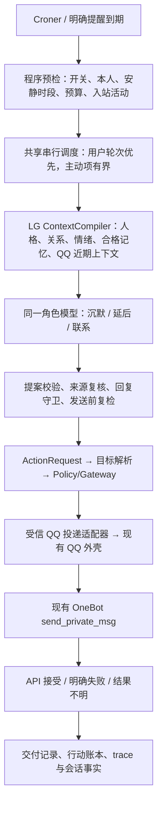

# QQ 主动联系 —— 现成方案评估与执行计划

日期：2026-10-06（UTC+8）。状态：**计划已编写 / 设计已冻结（WP0：ADR-110）/ WP1–WP4 判据层已交付 / 接线与 WP5–WP7 未开始 / 运行验收 NOT RUN / 生产未激活**。

用户目标：让苏沐薇在本人没有发送新 QQ 消息时，也能主动联系本人；优先寻找网上已有方案。本轮交付调研与执行计划，不安装依赖、不修改运行代码或生产配置、不发送真实 QQ 消息。

**建议路线：保留现有 NapCat + LG 共存核心，采用 Croner 作为时间触发组件；由 LG 本身决定保持沉默、延后或发送，并通过现有行动网关和 QQ 通道交付。** 完整机器人框架作为比较对象与设计参考，不建立第二份人格、记忆或回复权威。

用户已明确选择：**自主关心与明确约定的提醒，两种同等优先**。两类能力在同一候选版本中交付和验收；先建设共同接线，不以其中一类通过代替另一类。具体频率、安静时段与生产外发仍按本计划提出候选。

## 1. 成功标准与首版范围

首版完成必须同时满足：

1. 在没有新入站消息的情况下，运行时能产生真实的主动联系候选；角色基于同一人格、关系、情绪和有来源的上下文，自行选择说话或沉默。
2. 开启正式外发后，本人 QQ 能收到主动文字；来源、决定、授权、行动和发送回执能够逐项对账。
3. 本人仍能正常使用 QQ 与 Live2D；主动工作不串台、不产生合成用户发言、不扩大记忆采信资格。
4. 免打扰、停用、用户抢先发言、重复触发、断线、重启和发送结果不明都有可验证的处理规则。

| 范围 | 首版行为 | 退出条件 |
|---|---|---|
| 自主关心 | 在允许的空闲机会中，她可以想起有依据的近期话题、询问进展或开启轻量话题；也可以不发 | 角色选择质量与真实外发分别验收；定时器不能替代选择 |
| 明确提醒 | 本人明确要求的单次提醒，保存确定时间、原请求和指定接收渠道 | 创建、修改、取消、到期、重启恢复均有证据；不把任意目标自动变成提醒 |
| 接收对象 | 已绑定的本人、现有独立机器人号、好友文字私聊 | 模型和触发载荷不能提供或改变 QQ 号 |
| 使用控制 | 关闭、仅观察、正式启用；暂停/恢复；安静时段与频率限制 | 停用后未外发项停止；已发生的发送和记录保留 |
| 后续范围 | 周期订阅、多用户、群聊、图片/语音、主动查网页或执行桌面/文件任务 | 本计划不实施；不得从本人的 QQ 外发许可继承这些能力 |

“长时间没说话”只提供一次评估机会，不是必须发送的命令。没有回复只表示没有观察到新入站，不据此判断本人已读、故意冷落、心情或现实处境。她可以表达自身情绪，但不能借此连续催促本人回应。

## 2. 已核对的 LG 基线与缺口

基线为当前 `main` 混合工作树；调研时 HEAD 为 `2d64997290dff77142705d5bcae76130a00c36fd`。QQ/共存源码中存在未提交改动，不能用 HEAD 单独代表全部当前实现。WP0 须记录受影响文件指纹，不清理或接管其它会话的修改。

| 现状 | 核对依据 | 对本计划的影响 |
|---|---|---|
| QQ 已有白名单、鉴权、接收和发送 | `src/infrastructure/qq/onebot-private-client.ts`：`receive()` → `submit()` → 私有 `sendText()` | 复用现有 OneBot 连接与固定 owner；增加受信外发入口 |
| QQ 外壳只消费在途请求的结果 | `src/infrastructure/qq/lg-stdio-client.ts`：只接受有 pending 项的 `TURN_RESULT` | 核心主动发出的文字不会自动交付，必须追加受限协议与回执 |
| 生产已切到一个核心、两条入口 | [共存激活记录](QQ-Live2D-Coexistence-Activation-Record.md)；`src/main.ts` 的 `--coexist` 装配 | 主动调度放在唯一核心；QQ 外壳仍不打开数据库 |
| 正式轮次已串行、公平、有界 | `src/kernel/app/bridge/turn-scheduler.ts` 的 `FairTurnScheduler` | 在同一串行权威中加入低优先级主动工作，不并行调用另一套正式轮次链 |
| 有后台作业与水位存储 | `src/infrastructure/persistence/job-store.ts`、`src/kernel/contracts/job.ts` | 可以复用作业执行记录；它不是现成的持久化日程或投递箱 |
| `schedule` 已登记，但运行闸仍拒绝 | `assertTriggerEnabledInM3_5()`、`enqueueJob()` | 必须追加具名触发许可和新证据；不能因为枚举里有它就直接使用 |
| 有 `system_event` 和结构化归因 | `conversation-event.ts`、`attribution.ts` | 系统唤醒与角色输出可分别表达；现有人类入口不能伪装系统触发 |
| 有目标/承诺，尚无完整到时通知链 | `goal.ts` 的时间契约；`goal-proposal.ts` 的时间限制；M10/M10.1 局限 | 提醒采用独立、明确授权的通知排期；不以目标中有时间字段冒充定时提醒 |
| “任务自主档”由用户任务触发 | [ADR-099](../adr/ADR-099-productivity-skills-write-and-task-autonomy-activation.md) | 已开启的文件/浏览器/任务许可不自动授给后台联系 |
| 有限插话的来源是闭集 | `src/kernel/app/bridge/character-output.ts` | 自主闲聊、日程提醒不得塞进唤醒回应或查证提示路径 |

关联债项：[Tech-Debt Register](../Tech-Debt-Register.md) 的 **TD-19 / DC-1…3**（系统发起、授权、恢复与回复真相）。本次只解决“本人 QQ 主动文字联系”的纵切；后台记忆抽取、任意自主任务等余项继续独立保留，不能整体关闭 TD-19。

生产基线报告记录 schema 为 v13；它是已有记录，不是本轮新开真实库的读数。若需要新持久表，迁移号在实施时按当时注册表顺延，不提前占用 `0014` 或改既有 DDL。

## 3. 网上现成方案与采用判定

本轮查阅官方文档、GitHub 固定版本源码、依赖声明与许可证，并解析 tag 对应提交。以下是源码与元数据核对，**没有安装或运行本地兼容试验**。网页上的功能说明不等于 LG 接入已经通过。

| 候选 | 可直接提供的内容 | 兼容、依赖与许可 | 本计划判断 |
|---|---|---|---|
| [AstrBot 主动聊天插件](https://github.com/Pancakes-Labs/astrbot_plugin_proactive_chat) `v1.2.6` | 沉默触发、随机延后、持久状态、免打扰、上下文与主动发送 | 需 AstrBot >=4.24.0；依赖 APScheduler 3.x、aiofiles、FastAPI、uvicorn；AGPL-3.0 | 作为完整功能参照，不直接接管 LG 主动回复 |
| [AstrBot FutureTask](https://docs.astrbot.app/use/proactive-agent.html) | 未来任务、定时唤醒、OneBot v11 主动反馈 | 官方仍标实验性；依赖 AstrBot Agent/运行时；本体 AGPL-3.0 | 参考任务创建与管理语义；不为本功能重新引入 AstrBot 主 Agent |
| [OpenClaw Heartbeat](https://docs.openclaw.ai/gateway/heartbeat) / [Automations](https://docs.openclaw.ai/automation/cron-jobs) | 定期评估、无事静默、活动时段和定时工作管理 | `v2026.9.8` 包要求 Node >=24.16.0 <25 或 >=26.1.0；MIT；是完整 Agent 网关 | 参考“唤醒不等于通知”的机制；不升级 LG Node 22 或引入第二个网关 |
| [Croner](https://github.com/Hexagon/croner) `10.0.1` | 单次 Date/ISO 时间、Cron、IANA 时区、防重叠、暂停与停止 | Node >=18、ESM/CJS、TypeScript 类型、无运行依赖；MIT | **优先直接采用的时间组件**；持久化、授权和交付仍由 LG 负责 |
| [node-cron](https://github.com/node-cron/node-cron) `4.6.0` | 定时、时区、防重叠 | Node >=20、无运行依赖；ISC | Croner 本地试验失败时的替代候选；不同时装两套调度器 |

### 3.1 为什么不直接装主动聊天插件

固定源码核对发现，该插件会读取 AstrBot 会话/平台历史和 persona，调用 AstrBot Provider，并经 AstrBot 发送、保存历史。这些步骤分别见 [chat_flow.py](https://github.com/Pancakes-Labs/astrbot_plugin_proactive_chat/blob/635fc18eeb84e3c7b58661425359244552286835/core/chat_flow.py)、[llm_adapter.py](https://github.com/Pancakes-Labs/astrbot_plugin_proactive_chat/blob/635fc18eeb84e3c7b58661425359244552286835/core/llm_adapter.py)、[message_sender.py](https://github.com/Pancakes-Labs/astrbot_plugin_proactive_chat/blob/635fc18eeb84e3c7b58661425359244552286835/core/message_sender.py)。其默认流程不经过 LG 的 ContextCompiler、归因、回复守卫与行动账本。

要保留一个 LG 权威，需要替换它的上下文、模型、历史和交付接缝，并额外维护 Python/AstrBot 环境。本轮据此判断：**直接复用轻量时间组件，再补 LG 专属的选择与投递接线，更适合当前架构。** 这是兼容性判断，不是插件功能差或已运行失败的结论。研究借鉴行为与接口，不复制该插件实现代码。

此前 [QQ × Live2D 兼容试验](QQ-Live2D-Coexistence-WP1-Compatibility-Trial.md) 已选择现有 NapCat + LG 路线，本功能不重新替换已激活的双入口方案。

### 3.2 固定版本与核对记录

| 对象 | 已解析的版本与 commit | 一手依据 |
|---|---|---|
| Croner | `10.0.1` → `adc86215e92e4f7cceaf8127dfcd1b514ef7bafc` | [固定 README](https://github.com/Hexagon/croner/blob/adc86215e92e4f7cceaf8127dfcd1b514ef7bafc/README.md)、[包模板](https://github.com/Hexagon/croner/blob/adc86215e92e4f7cceaf8127dfcd1b514ef7bafc/build/package.template.json)、[npm 发行元数据](https://registry.npmjs.org/croner/10.0.1)、[MIT](https://github.com/Hexagon/croner/blob/adc86215e92e4f7cceaf8127dfcd1b514ef7bafc/LICENSE) |
| 主动聊天插件 | `v1.2.6` → `635fc18eeb84e3c7b58661425359244552286835` | [metadata](https://github.com/Pancakes-Labs/astrbot_plugin_proactive_chat/blob/635fc18eeb84e3c7b58661425359244552286835/metadata.yaml)、[requirements](https://github.com/Pancakes-Labs/astrbot_plugin_proactive_chat/blob/635fc18eeb84e3c7b58661425359244552286835/requirements.txt)、[许可证](https://github.com/Pancakes-Labs/astrbot_plugin_proactive_chat/blob/635fc18eeb84e3c7b58661425359244552286835/LICENSE) |
| node-cron | `v4.6.0` → `0be2ca03ffebc79fa823081b8a44bff6f731a583` | [package.json](https://github.com/node-cron/node-cron/blob/0be2ca03ffebc79fa823081b8a44bff6f731a583/package.json) |
| OpenClaw | `v2026.9.8` → `fc23bc864e4553c2d215e479eeec47b67a0bf943` | [package.json](https://github.com/openclaw/openclaw/blob/fc23bc864e4553c2d215e479eeec47b67a0bf943/package.json)、[MIT](https://github.com/openclaw/openclaw/blob/fc23bc864e4553c2d215e479eeec47b67a0bf943/LICENSE) |

Croner 包 integrity 已读回：`sha512-ixNtAJndqh173VQ4KodSdJEI6nuioBWI0V1ITNKhZZsO0pEMoDxz539T4FTTbSZ/xIOSuDnzxLVRqBVSvPNE2g==`。实施时精确锁定版本并核对锁文件与产物，不自动升级为 latest。**Croner 的防重叠是进程内性质，不提供重启持久化或 QQ exactly-once。**

WP1 的本地选择条件：Node 22/tsx/ESM 导入、单次触发、Asia/Shanghai 跨日、重复启动防重叠、停止后无迟到回调、事件循环正常退出全部通过。失败时保留证据，逐项核对 node-cron；替代组件不能降低持久化或外发验收标准。

## 4. 建议设计：时间提供机会，角色决定联系



### 4.1 两类触发

**自主关心**：运行时在活动时段定期检查，程序先筛去不合格机会，再把“可以联系本人”的系统机会交给角色。没有合格材料时可选择轻量问候或沉默，不伪造本人近况。关系/情绪影响意愿与语气，不成为突破安静时段、限额和停用的理由。

**明确提醒**：只从真实本人请求创建通知意图。必须有原事件引用、时间解释、时区、接收对象和取消状态。首版支持确定时间的单次提醒；“以后提醒”“有空再说”等不确定表达只澄清，不偷偷排期。提取出的时间是候选，程序校验后才落盘，回复必须依据实际落盘事实说已设置。

两类触发的选择权限不同：自主关心允许角色选择沉默；已接受且到期、未取消、策略仍允许的明确提醒，角色只决定措辞，不能以“今天不想说话”自行取消。该类候选的 silence/defer 输出不能记作提醒完成。模型失败时，可使用已校验通知内容的程序模板交付，并标记模板来源；模板不执行原请求中引用的工具指令。仍受安静时段、授权撤销、限额、时效和未知交付规则限制。

提醒不是另造一份目标/承诺：若绑定已有 Goal/Commitment，仅保存其 id 与 revision；结清、更正、遗忘或取消时重新核对资格。普通目标中出现截止时间，不自动取得 QQ 通知许可。独立的“十分钟后提醒我喝水”可仅创建通知意图，无需强制生成 M10 目标。

### 4.2 角色选择与认知边界

- 采用同一生产角色模型和角色状态，由既有 ContextCompiler 装配专用系统机会。**禁止**将“请主动找本人”包装成新的 `user_message`，或调用普通 `ChatSession.send()` 冒充人类入站。
- 私有选择输出采用严格闭集提案：`silence / defer / send`，附理由码、已有依据引用；延后只允许程序给定范围。首次采用现有严格 JSON 模式，不要求未验证的原生 function calling。
- 首版建议一次模型调用同时产生选择与候选文字；选择协议不进入 QQ 正文。候选不合规或守卫判不过就丢弃，不触发无限修复对话。
- 模型不得指定收件 QQ、启用工具、建立无限循环或直接修改调度状态。通知配置和用户的暂停/恢复在正式入站控制链处理。
- QQ 的近期窗口只读 QQ 自己的会话；共享长期记忆、关系、情绪、Goal/Commitment 按现有资格使用。其它入口近期原文不因主动调度流入 QQ。
- 调度事件、候选文字与模型自身猜测不能升级成用户事实、Belief 背书或长期记忆。实际助手发言按真实来源进原事件链；用户后来回答时才走既有用户消息与明确记忆操作。
- 候选引用必须在生成前和发送前核对；遗忘、来源失效或任务结清使旧候选失效。ContextCompiler 应沿用现有遗忘遮蔽，不读绕过遮蔽的原始历史副本。

### 4.3 归因、权限与一个执行权威

保持 [ADR-030](../adr/ADR-030-action-request-is-the-only-execution-entry.md) 与 [架构不变量](../architecture/invariants.md)。拟登记最小能力 `qq.private.send_text`：副作用 `write`、风险 **R2**、固定本人目标、幂等必需；名称是计划候选，尚未登记。
> ⏩ **2026-10-06（WP5 登记时补记）**：候选名**不可登记** —— `ID_PATTERN` 段里不许有下划线。
> 最终登记名 = **`qq.private.message` / `send`**（语义一字未变：`write` / R2 / 固定本人 / 幂等必需 /
> **不在**任务候选表里）。见 [`WP5 Record`](QQ-Proactive-Messaging-WP5-Record.md)。

权限是**新能力的持续外发许可**：模式、本人范围、允许触发种类、时段、频率和撤销版本共同构成许可。正式开启后，合规消息可自动发送，无需逐条审批；不把现有自动回复许可解释为已批准主动联系。已有 [M6.5-D1](../m6.5/M6.5-Lv2-Capability-Integration-Plan.md) 保留，新 ADR 单独记录主动外发范围。

七槽归因至少区分：系统定时唤醒者、角色选择与内容产出者、QQ 执行器、持续许可与原提醒请求、本人接收者、触发引用和本次 trace。系统/角色/执行器按实际因果登记；不能仅改 `requestedBy` 就声称归因成立，也不能把预先许可当成用户刚刚说了一句话。行动 Axis B 继续不适用。

R2 只授给这项本人私聊操作，**不提高全局 `actionMaxRiskLevel`**、不自动继承文件写入、浏览器操作、搜索或任意 MCP。目标由现有绑定生成确定证据，不接受模型提供的 `user_id`。保持 M6.5-D2 的后台非干扰通道，不使用鼠标、键盘、窗口或共享剪贴板发送。

### 4.4 用户优先、跨入口活动与发送前复检

主动项接入现有共享串行调度，最多一个候选在途。每次选下一个任务时优先服务两个人类入口；后台项不排成长队，不持有音频播放锁。已开始的模型调用仍可能增加等待，须测量，不能宣称零延迟影响。

在接收真实入站时立即更新活动版本，不能等入站轮次执行完才更新。生成前读取版本，发送前复核版本、授权版本、来源 revision、目标、连接、时段和额度。本人在 QQ 或皮套开始新一轮对话，应取消旧自主关心候选；明确提醒按其明确许可重新判断时效。

停用和新入站须能中止候选模型调用；迟到结果不提交。最终复检、预算占用与投递意图提交在同一核心串行边界内完成。网络请求已经发出后不能撤销，记录实际先后与竞态范围。

### 4.5 QQ 协议与单一连接

复用当前 QQ 外壳持有的 OneBot WebSocket。核心经 Gateway 许可后，由专用适配器向已鉴权 QQ 连接发出闭集投递命令；外壳返回绑定该 deliveryId 的回执，**不另开生产数据库**。

拟追加核心→外壳 `DELIVER_QQ_TEXT`、外壳→核心 `REPORT_QQ_DELIVERY`（命名在 WP0 冻结）。绑定连接、入口、deliveryId、attempt 与有界文字；目标始终从本机绑定取值。旧 `SUBMIT_TURN/TURN_RESULT` 保持原回复语义，皮套不能消费或提交 QQ 投递回执。

普通回复与主动文字共用 QQ 发送串行队列，避免相互穿插和重复输出；普通回复优先。多个 QQ 外壳连接不能各投递一份，须有唯一投递连接，替换与断开采用连接代次，旧代次回执不覆盖新状态。队列、确认超时和关闭排空均有界。

## 5. 持久化、交付真相与重启

Croner 仅管理内存时间触发。通知意图、限额、未回复计数、发生实例和交付状态必须在现有 LG 数据权威中持久化，否则重启会重置频率或重复发言。

建议追加**一张专用通知意图/实例表**，保存 owner/character/QQ 会话绑定引用、触发种类、原来源引用、排期与时区、许可/来源版本、occurrenceKey、有界候选正文及指纹、最终助手事件引用、状态、预算占用和 OneBot messageId。既有 `character_jobs` 只管处理尝试的运行状态，不能把 `job.completed` 当成已送达。表布局与索引由 WP0/WP2 确定，生产迁移需形成具体候选后执行授权流程。

时间触发实例采用稳定键（通知 id + 计划版本 + 本次预定时刻）；自主关心采用 owner + 许可版本 + 时间机会键。发送幂等由**持久实例与唯一占用**保证，不靠内存 Set 或随机 requestId。已有 job 的“failed 可重建”不能直接变成外发重试规则。

```text
pending → evaluating → prepared → dispatching → api_accepted
    └──────────────→ skipped / cancelled / expired
                            dispatching → failed_confirmed / delivery_unknown
```

| 情况 | 必须记录 | 允许的后续行为 |
|---|---|---|
| 尚未交给发送器 | 仍是未发送；原因明确 | 连接恢复后重新预检，时效允许才处理 |
| 发送前确定连接不可用 | 未发送，不报已送达 | 自主问候丢弃；提醒在有效期内等待连接 |
| OneBot 明确成功且有 message_id | `api_accepted` 与实际回执 | 记为平台接口接受，**不记本人已读** |
| 明确拒绝 | `failed_confirmed` 与理由 | 首版不自动重发；通过新请求处理，保留原实例 |
| 超时、发送后断线、发出后未落回执即崩溃 | `delivery_unknown` | **不自动重发**，不声称一定没送出；占用频率额度 |
| 重启时遗留 dispatching | 结果不明，原实例保留 | 隔离该实例，避免重复；不能按 failed 作业一律重跑 |

QQ 协议没有提供本计划可依赖的跨崩溃幂等发送凭据；本次不承诺 exactly-once。未知状态采取避免重复的策略，代价是可能漏发一条提醒。发送前持久标记也可能留下“标记后、网络前崩溃”的未知项，必须列入局限。

候选正文暂存通知实例的有界私有内容字段，ActionRequest、行动账本和 trace 仅保存实例引用/指纹/长度；**不把正文放进 ActionRequest.arguments、作业错误信息或遥测**。核心到 QQ 的受信线缆和最终私聊需要正文。只有平台接受后才向 QQ 会话追加正式助手输出及对应交付事实，标明 API 接受不代表本人已读；候选不能提前当作已经发生的对话，也不能触发关系、情绪或反思消费者。明确失败与结果不明继续保存通知实例，不伪造一条已送达助手消息。回执已成功但会话事件尚未追加时崩溃，恢复须按实例键补记而不重发；未留存成功回执则维持未知，不猜测实际交付。

停止/重启时先停新触发，再取消未发送候选、排空在途投递、按现有 late-write fence 和 INC-01 关闭链收尾。一个调度器、一个库持有者；不另启会开 `data/pglite` 的提醒进程。

## 6. 首版建议参数与成本

下表是**待冻结的建议值**，不是当前配置或已获批准的外发规则。实现采用一个具名策略配置，不为每项规则建设新的管理服务。

| 项目 | 建议默认值 | 约束 |
|---|---|---|
| 模式 | `off`；验证档 `shadow`；正式档 `on` | shadow 完整产生选择与审计，不调用真实发送 |
| 时区 / 自主活动时段 | Asia/Shanghai，09:00–22:00 | 不继承宿主机时区；22:00 后不自主问候 |
| 机会检查 | 每 30 分钟 | 首先做程序预检，不意味着每次调用模型或发消息 |
| 自主关心空闲 / 冷却 | 两路真实入站空闲至少 2 小时；主动关心间隔至少 3 小时 | 连续聊天不评估；重启不重置 |
| 自主关心上限 | 每日最多 2 条；有 1 条未得到新入站回应时暂停继续关心 | API 接受与结果不明均占额，不因模型换理由绕过 |
| 模型评估预算 | 自主评估每日最多 4 次；单次 15 秒、输出最多 500 token | 无隐式重试；上下文另设预算并记录实际输入 token |
| 明确提醒 | 首版最多 20 个待办；全类主动消息每日最多 10 条 | 明确许可独立于关心限额，但不绕过总发送上限 |
| 迟到处理 | 自主机会过期丢弃；单次提醒逾期 30 分钟后标 expired | 休眠/重启不批量补发历史问候；过期不伪报已提醒 |
| 夜间明确提醒 | 普通提醒顺延到下个允许时刻；本人明确指定夜间时间可仅对该条例外 | 创建时说明最终时刻；不能把一个例外变成全局放开 |

控制优先提供确定的暂停/恢复/状态操作，并支持明确自然语言映射；否定、引用、“她会不会主动找我”等讨论不修改设置。恢复不补发积压关心。失去授权、QQ 绑定改变或配置版本升级后，旧候选重新判定，不沿用旧许可。

自主关心每天最多 4 次额外模型请求，实际成本随 ContextPacket 输入而变化；明确提醒单独计入总日预算。预检跳过不出站，不将人格/记忆交给第三方插件或增加新的模型提供商。电脑休眠、LG/NapCat 停止时无法实时发送，本地方案不提供离线常驻云服务。

## 7. 能力影响矩阵

| 能力/状态 | 复用或新增 | 权限与副作用 | 认知/记忆边界 | Level 1 / Level 2 验证 |
|---|---|---|---|---|
| QQ 自动回复 | 复用 | 现有入站预授权保持 | 真实本人消息的现有资格 | 本人回复接收 / 原回执与会话链 |
| 人格、关系、情绪、记忆、目标 | 只读复用；实际助手发言仍走原消费者 | 不增加任意认知写入 | 系统机会不变成用户事实；沿用遮蔽 | 角色语气与真实输出 / 实际 ContextPacket 和来源引用 |
| 定时唤醒 | 新增 Croner 适配及持久恢复 | 内部 schedule，不能自己取得外发权限 | 不产生用户发言 | 实际时间触发 / 作业和实例记录 |
| 角色主动决定 | 新增受限决策入口 | 只能沉默、延后或提议本人文字 | 内容保持 character 来源 | 人审适合程度 / 提案与快照版本 |
| 本人 QQ 主动文字 | 新增登记能力与持续许可 | 固定目标、R2、幂等、额度、撤销 | 交付状态与内容来源分开 | 本人收到 / ActionResult、ledger、messageId |
| 明确提醒排期 | 新增通知意图 | 只接受真实请求；创建/取消如实反馈 | 不自动生成记忆或重定义目标 | 到时提醒与取消效果 / 意图、来源、实例与恢复记录 |
| 搜索、文件、浏览器、群聊、多用户 | 本批新增 **NONE** | 主动联系不授予这些能力 | 不沿用用户当前任务授权 | 对越界提案零执行 / 拒绝记录 |

## 8. 工作包、交付物与通过条件

| 工作包 | 具体工作 | 交付与通过条件 |
|---|---|---|
| WP0：基线与设计 | 固定当前入口、消费者、来源资格、作业闸、归因工厂、协议、停机链；冻结本计划的权限、时间和竞态规则 | 新 ADR（实施时分配编号）、能力/归因表、源指纹、迁移需求；历史定义与新的 scoped schedule 许可关系明确 |
| WP1：现成组件探针 | 隔离安装精确 Croner 版本；Node 22/ESM/tsx、时区、单次时间、保护、停止/退出检查 | 兼容读数非空；固定 lockfile；失败时保留记录并按 §3 切换候选，禁止以安装成功收口 |
| WP2：持久通知与时间 | 追加通知表；复用作业记录但只对具名主动处理器启用 schedule；绑定真实系统触发事件与序号；重启恢复/时效/配额 | 单次实例唯一；旧处理器仍维持原 trigger 闸；跨日、时钟回退、休眠与重启不重置额度或刷屏；新迁移正负控 |
| WP3：通知入口与用户控制 | 同时接入空闲关心机会与正式入站单次提醒；创建/改时/取消、时间歧义澄清、夜间规则、暂停/恢复；目标结清/遗忘关联复核 | 两类触发均有真实来源；创建后真持久，未创建不说已设；同实例取消有效；重启不漏恢复 |
| WP4：角色选择与提醒措辞 | 专用 ContextCompiler、严格提案、来源复核、现有回复守卫；关心可沉默，明确提醒按约履行；shadow 模式 | 关心正控能选 send、沉默负控能选 silence；到期提醒不能因角色 silence 被标完成；零假用户事件、零自动记忆；失效/迟到候选无提交 |
| WP5：QQ 主动交付 | 登记能力、固定目标解析、scoped R2 许可、Gateway 适配器、闭集双向协议、唯一 QQ 投递连接、普通回复优先 | 模拟 OneBot + 真核心无入站情况下，两类候选均实际执行 send API；messageId/未知状态/来源/账本对账；另一路保持可用 |
| WP6：整链、行为与回归 | 下节全矩阵、量具三段式、有限真实模型、人审；压力与恢复；所列回归 | 工程面与语义、人审分别判；完整离线 CI EXIT 0；故意绕过不得被门接受；全部失败档保留 |
| WP7：交付与正式激活 | 使用/回滚说明、激活候选、迁移预演、生产开关/持续许可候选；获准后正常切换；本人自然首用 | 激活前材料完整可审；真实库按 INC-01 执行；记录自然收到、API 回执和账本；未观察到首用如实记 NOT OBSERVED |

顺序：WP0 → WP1 → WP2 → WP3 → WP4 → WP5 → WP6 → WP7。WP3–WP5 每个包都覆盖两类触发；两类均通过才进入正式交付，不单独发布其中一类来宣称完成。按工作包汇报事实与剩余边界，不承诺未经探针确认的日历工期。

### 8.1 预计改动位置

- 时间与投递 IO：`src/infrastructure/runtime/`、`src/infrastructure/qq/`；SQL 仅在 `src/infrastructure/persistence/`。
- 纯提案、策略与状态：`src/kernel/contracts/`、`src/kernel/policies/`；新增能力在 `src/kernel/action/`，不在纯层导入 Croner/SQL/网络。
- 角色装配与单持有生命周期：`src/main.ts`、`src/kernel/app/`；复用共享核心，不拆第二个核心。
- 受限协议、调度接缝：`src/kernel/app/bridge/`、`scripts/qq/chat.ts`；只追加本功能必要消息和背景调度支持。
- 专项门：`scripts/`、`evals/`、`artifacts/post-lv2/qq-proactive/<runId>/`；依赖与命令在实施时点追加到共享配置。

新命令暂拟 `postlv2:qq-proactive:{verify,matrix,measurement,eval,live}`；**现在尚不存在**。不预建通用日程平台、WebUI、事件总线或外发渠道框架。

## 9. 验收矩阵与测量有效性

| 场景 | 必须观察到的结果 |
|---|---|
| 无新入站，满足自主机会 | 真核心能提出并发送一次本人文字，不依赖合成用户消息 |
| 没有话题，模型选择沉默/延后 | 零发送；延后有上限且不形成无限立即唤醒 |
| 近期话题、关系或情绪不同的固定材料 | 实际入模确含对应状态；发送选择与语气逐案评审，不能只检查 prompt 标签 |
| off / shadow / on | off 不评估；shadow 不调用发送；on 仅许可范围内可发 |
| 生成中或发送前收到 QQ 新消息 | 旧关心候选失效，用户正常回复，无错误复活 |
| 皮套新入站 / 播放 / 用户打断 | 真实入站抑制旧关心；QQ 不被播放占用；取消不跨入口 |
| 连续两次 tick、回调重入、同实例重启 | 同 occurrence 只产生一个外发尝试；额度保留 |
| 未回复、冷却、每日关心与总消息限额 | 达限后零发送；未知交付也不能借重试绕过 |
| 跨日、时钟回退、夏令时测试、睡眠后恢复 | 稳定 occurrence/额度；不批量补发关心；跨日以指定时区计算 |
| 安静时段 / 明确夜间提醒 / 模糊时间 | 普通规则、单条例外、澄清分别正确；最终排期有原请求依据 |
| 创建/改时/取消提醒后重启 | 状态真实保存；旧计划版本不再触发；正常到期提醒能发 |
| 到期明确提醒，模型选 silence / 超时 / 坏 JSON | 不伪报已完成；可交付的校验内容采用程序模板，记录来源；其它阻止原因具名 |
| 已结清目标、取消承诺、遗忘来源 | 关联提醒与关心候选重新判定；失效内容不复述 |
| 多个 QQ 外壳、旧连接晚到回执 | 单一投递连接；旧代次不能确认别的 deliveryId |
| 身份/QQ号/入口/许可/提案被伪造 | 零错发、零越权行动、零认知污染 |
| 候选企图搜索、写文件或用任意 MCP | 零执行，不借现有任务自主档取得后台工具许可 |
| 普通 QQ 回复与主动文字同时就绪 | 顺序可核对；普通回复优先，无重复或串台 |
| OneBot 明确成功/拒绝/超时/发出后断线 | 平台接受、确定失败、结果不明分别记录，不伪报已读 |
| 崩溃发生在标记前/标记后/发出后/回执后 | 无无条件重发；未知实例保留；无重复预算释放 |
| 模型超时、坏 JSON、守卫拒绝、取消 | 失败具名，无候选泄漏或候选驱动的认知事件；同进程新请求恢复成功 |
| 停用/正常关闭/重启 | 无迟到网络发送或晚写；租约与消费者仍只有一个 |
| 本人真实 QQ 收到主动文字 | 有实际外部接收证据和对应 messageId/行动账本，不能只用 fixture 替代 |

量具必须覆盖正控、故意越界/错路由/假回执/双重发送的负控、恢复三段式，且 `measured_count > 0`。正控包含必发的确定提醒与可发的自主候选，防止“永远沉默”也通过。所有安全场景要求零错发、零假用户归因、零越权动作、零已失效内容发送；这是固定样本主张，不外推为开放对话永不出错。

**行为评估建议**：冻结 24 案（8 案有合理联系机会、8 案应沉默、8 案撤销/安静时段/来源边界），每案 3 次真模型，共 72 次；保留逐案原始决定、上下文指纹和各轮结果。许可/边界案不得外发；应沉默案全部沉默；合理机会案 send 比例建议至少 75%，并由本人盲审“像她、话题有依据、时机合适、无需被迫回应”。这些阈值是待冻结建议，不用反复重跑或修改金标凑通过。固定脚本门不证明人格质量。

性能分别记录机会检查数/跳过理由/模型调用数、输入输出 token、决策耗时、用户等待、Gateway 耗时、OneBot 确认耗时、总发送和未知数。以相同用户材料比较关/开主动功能；有在飞决策时测量用户新增等待。模型期限建议 15 秒，不宣称它就是全部交付延迟上限。

### 9.1 回归与证据层级

实施后的最低回归：`pnpm typecheck`、`pnpm qq:verify`、`pnpm postlv2:bridge:verify`、`pnpm postlv2:transport:verify`、`pnpm postlv2:coexist:verify`、`pnpm postlv2:coexist:matrix`、`pnpm postlv2:coexist:shells`。

行动/归因与上下文改变加跑对应 `m4.5:*`、`m5.1.1:*`、`m3.5:*` 与 ContextCompiler 门；迁移/生命周期加跑 `inc-01:test / verify / measurement:verify` 与 migration 门；若触及目标、约定或记忆，按 AGENTS.md 增补该模块门。旧门的 M3.5 冻结语义与新调度许可分别记录，不删旧断言来制造全绿。

代码交付前完整串行执行 `pnpm m4.5:ci` 并取得 EXIT 0。真实模型验证走 `pnpm with-test-model` 和新隔离库；先 mock OneBot 验证全链，正式激活后再验证本人真实接收。**真实 QQ 外发测试必须在明确授权的本人范围内，不发送研究或合成测试正文到正式聊天。**

所有合成对话使用 `isolateDatabase()`。如需生产副本，只从已验证静止快照制作一次性副本，不热复制/直接打开在用的真实库。测试前后比生产目录树摘要，不能用 git status 证明 `data/` 未变。源码指纹、模型档、触发策略、来源适用性、runId 与 FAIL/INVALID/NOT RUN 全保留，聚合门只读落盘证据。

最终至少有 Level 1（本人真实 QQ 接收）与 Level 2（触发、事件、行动与回执），并分列组件、隔离整链、真模型选择、人审、生产激活、自然首用。没有新的真实接收证据就不能称“主动联系已在生产验证”。

## 10. 正式激活、撤销与回滚

本轮授权覆盖研究和计划。WP7 先形成包含实现指纹、迁移预演、参数、接收账号绑定、成本、失败处理和回滚的具体激活候选，再处理生产授权；既有 QQ 自动回复与共存授权继续有效，不重复请求。新的主动外发与新增生产迁移不能从旧授权推导。

1. 先完成 WP0–WP6，并在隔离库确认 off/shadow/on 及恢复；呈交可审查的激活候选。
2. 正式切换获准后，停止新触发和新轮次，排空发送与消费者，核对 cleanClose 和租约释放。
3. 如有新迁移，按当时编号做 verified snapshot、迁移及读回；沿用 INC-01 租约 → 静止源快照 → 校验 → 开库链。不自动删旧快照。
4. 先在正式 shadow 档观察真实上下文与选择，不发送；按已获准的持续许可切到 on，记录政策版本及启用时刻。
5. 在实际空闲机会中由角色作决定，本人确认真实收到；核对 messageId、实例、ActionResult 和账本。没有消息时区分合法沉默、策略阻止与失败，不强塞假用户轮次。

即时暂停使新候选停止，尚未提交网络的项取消。配置回滚采用关闭主动模式并正常重启，现有 QQ 自动回复、双入口和正式记忆继续运行；已经创建的提醒与通知记录保留但禁发。再次启用须重新检查时效和许可，不补发积压问候。

回滚不删除会话、投递/行动记录、迁移表或真实记忆，不自动恢复数据库快照；未知交付保持未知。彻底撤销持续许可使旧候选及排期失去外发资格，随后新许可采用新版本，不能以改回 on 自动复活旧授权。

## 11. 当前交付与剩余限制

| 状态槽 | 本轮结论 |
|---|---|
| 官方文档 / 版本 / 依赖 / 许可核对 | 已完成；优先候选为 Croner 10.0.1 |
| LG 现有发送、共存、作业与归因接缝核对 | 已完成源码审查；当前生产状态来自既有激活记录 |
| 设计裁定 / 参数冻结 | **WP0 已冻结**：[`ADR-110`](../adr/ADR-110-qq-proactive-messaging.md)（`ACCEPTED / DESIGN FROZEN`，`D01`–`D14` 含 `D04a`/`D05a`/`D05b`/`D09a`/`D09b`）+ 基线 [`WP0-Baseline`](QQ-Proactive-Messaging-WP0-Baseline.md)（runId `qq-proactive-20261006T193748-53442a14`） |
| 依赖本地兼容 / 持久化 / 主动选择 / 投递 / 提醒实现 | **WP1–WP4 判据层已交付**（Croner 10.0.1 探针 6/6 · 迁移 **0014/0015** · 具名 `schedule` 许可 + 修掉撞键绕闸 · 提醒入口/控制面/机会预检 · 闭集提案/权限差/来源复核 · 门 `postlv2:qq-proactive:verify` **73/0**）；**接线**（`main.ts`）与 WP5 投递未开始 |
| 离线门 / 真模型行为 / 人审 / 真实 QQ 接收 | **NOT RUN** |
| 新能力生产激活 / 自然首用 | **NOT ACTIVATED / NOT OBSERVED** |

明确保留：本机停机或休眠无法准时外发；无本人已读证明；发送结果不明可能漏提醒；长期开放聊天的时机、措辞和事实正确性不由固定样本保证；共享模型与核心仍可能增加用户等待。新功能只覆盖本人主动文字联系，不关闭多用户隔离、回复确认、后台记忆抽取或通用自主任务的旧债。
