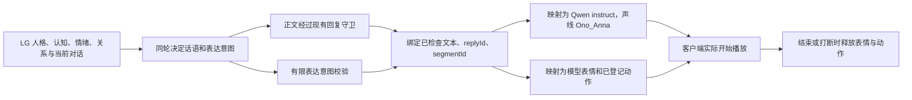

# 苏沐薇表达意图到语音与 Live2D 的 GitHub 复用调研

日期：2026-10-04。用户要求优先寻找 GitHub 现成方案。本轮完成源码、许可证、当前工程和候选纯函数检查；未接入新的表达控制，未进行情绪语音试听或动作渲染验收。

## 1. 推荐组合

保留当前 **LG → Open-LLM-VTuber → Qwen3-TTS / Live2D** 链路：直接复用 Open-LLM-VTuber 的逐句表情载荷和 Qwen3-TTS 的 `instruct`；借鉴 AITuberOnAir 的模型动作目录、情绪绑定和语音播放期间的动作管理；AIRI 的参数混合与复位作为补充参考。

此次找到的候选都需要 LG 适配。最重要的新增接线是：**LG 在决定这句话时同时决定有限的表达意图，程序把意图映射为语气、表情和动作。** 皮套和语音模型只执行，不成为第二个人格、记忆或对话后端。

**内在情绪、表达意图、任务状态分别建模。** 她心情低落时仍可以决定温柔地安慰人；不能把负面情绪一律翻译成生气表情。`thinking / listening / failed` 等任务状态仍依据程序事实，不能由模型的语气标签覆盖。

## 2. GitHub 候选与复用边界

以下提交均已读取实际源码及根许可证；完整文件指纹见本轮 `sources.json`。这是截至本次调研的固定快照。

| 候选 | 已确认能力 | 在 LG 中的用途与限制 |
|---|---|---|
| [Open-LLM-VTuber](https://github.com/Open-LLM-VTuber/Open-LLM-VTuber) · MIT | `Live2dModel` 按 `emotionMap` 解读已知标签；`SentenceOutput` 分开携带正文、显示文本、`Actions.expressions`；TTS 管理器随音频传递动作载荷 | 直接复用当前已安装的外壳。`Actions` 没有通用身体动作字段；合成接口只传入文本，表情载荷不会自动变成 Qwen 语气指令。需要补局部适配 |
| [Qwen3-TTS](https://github.com/QwenLM/Qwen3-TTS) · SDK Apache-2.0 | `generate_custom_voice` 接收独立 `instruct`，编码后与正文、speaker 一起进入模型生成 | 直接复用现有 1.7B CustomVoice / Ono_Anna。表达语气控制不要求再下载另一套 TTS 模型；本轮没有验证具体指令的听感、稳定性或额外延迟 |
| [AITuberOnAir](https://github.com/shinshin86/aituber-onair) · MIT | Live2D 示例按模型登记动作组和索引、配置情绪对应动作，检查资源是否存在；动作在语音播放期间重复，结束后交还 idle | 最贴近“意图 → 动作执行”的小组件参考。动作管理依赖 Pixi 的 `internalModel` 和私有队列字段，当前 Cubism 前端不能直接照搬。示例部分视觉特效会提前于 TTS 开始，不能据此认定全部表情已与播放同步 |
| [AIRI](https://github.com/moeru-ai/airi) · MIT | 表情/参数控制、持续时间、默认值复位、参数 Add/Multiply/Overwrite 混合；语音管线有分段、排队、播放事件与取消 | 参考参数控制和生命周期，适合补小幅点头、偏头的执行器设计。控制器依赖 Vue/Pinia/Pixi；不引入完整应用。它开放的任意参数工具和持久默认值写入不直接暴露给 LG；语音 `special` 事件时机也要重新核对 |
| [ChatVRM](https://github.com/pixiv/ChatVRM) · MIT | 用有限情绪标签描述话语，执行端区分情绪、眨眼与口型 | 标签协议的简洁参考。仓库已于 2025-05-27 归档，执行对象是 3D VRM，当前 Live2D 不采用它的渲染链路 |

固定提交：

- Open-LLM-VTuber：`992309c0aa19845960228f880013d4685fde93b5`，沿用本机版本。
- Qwen3-TTS：`022e286b98fbec7e1e916cb940cdf532cd9f488e`，上游源码快照；本机已安装 SDK 为 `qwen-tts 0.1.1`，也已核对其 `instruct` 接口。
- AITuberOnAir：`012396a111e2cf5b8e688d2cbc0d785b14002db5`。
- AIRI：`7684415927147a8f64bb442ff0069c33816efedd`。
- ChatVRM：`b542aa00e19dccf9fc48ba340cf7eee011d2329a`。

关键源码入口：

- Open-LLM-VTuber：[表情映射](https://github.com/Open-LLM-VTuber/Open-LLM-VTuber/blob/992309c0aa19845960228f880013d4685fde93b5/src/open_llm_vtuber/live2d_model.py)、[逐句输出](https://github.com/Open-LLM-VTuber/Open-LLM-VTuber/blob/992309c0aa19845960228f880013d4685fde93b5/src/open_llm_vtuber/agent/output_types.py)、[TTS 载荷](https://github.com/Open-LLM-VTuber/Open-LLM-VTuber/blob/992309c0aa19845960228f880013d4685fde93b5/src/open_llm_vtuber/conversations/tts_manager.py)。
- Qwen：[CustomVoice 语气接口](https://github.com/QwenLM/Qwen3-TTS/blob/022e286b98fbec7e1e916cb940cdf532cd9f488e/qwen_tts/inference/qwen3_tts_model.py)。
- AITuberOnAir：[模型动作映射](https://github.com/shinshin86/aituber-onair/blob/012396a111e2cf5b8e688d2cbc0d785b14002db5/packages/core/examples/react-live2d-app/src/lib/live2dMotions.ts)、[语音期间动作管理](https://github.com/shinshin86/aituber-onair/blob/012396a111e2cf5b8e688d2cbc0d785b14002db5/packages/core/examples/react-live2d-app/src/lib/speechMotionHold.ts)、[示例行为说明](https://github.com/shinshin86/aituber-onair/blob/012396a111e2cf5b8e688d2cbc0d785b14002db5/packages/core/examples/react-live2d-app/README.md)。
- AIRI：[表情工具](https://github.com/moeru-ai/airi/blob/7684415927147a8f64bb442ff0069c33816efedd/packages/stage-ui-live2d/src/tools/expression-tools.ts)、[表情混合和复位](https://github.com/moeru-ai/airi/blob/7684415927147a8f64bb442ff0069c33816efedd/packages/stage-ui-live2d/src/composables/live2d/expression-controller.ts)、[动作参数管理](https://github.com/moeru-ai/airi/blob/7684415927147a8f64bb442ff0069c33816efedd/packages/stage-ui-live2d/src/composables/live2d/motion-manager.ts)、[语音管线](https://github.com/moeru-ai/airi/blob/7684415927147a8f64bb442ff0069c33816efedd/packages/pipelines-audio/src/speech-pipeline.ts)。
- ChatVRM：[有限情绪标签提示](https://github.com/pixiv/ChatVRM/blob/b542aa00e19dccf9fc48ba340cf7eee011d2329a/src/features/constants/systemPromptConstants.ts)。

软件许可证允许的复用范围不自动覆盖 Cubism SDK、模型权重或 BOOTH 皮套。后续若复制源码，保留对应版权和许可证通知；本轮未重新分发第三方代码或皮套素材。

## 3. 当前工程还缺哪些接线

| 实际读回 | 对接影响 |
|---|---|
| [外壳适配器](../../scripts/postlv2_vtuber_runtime.py) 对每句生成 `Actions(expressions=[0])`，Qwen 的 `instruct=""` | 现在固定 neutral，没有把 LG 的表达意图送给任何一个执行端 |
| [Avatar 契约](../../src/kernel/contracts/avatar-state.ts) 的受控表情只有 neutral、smile、thinking、sorry、surprised、listening；说话时有情绪字段即选 smile | 这是程序状态呈现的现有简化规则，不能宣称已经实现完整的情绪或表达意图映射；新增映射须明确与现有任务优先级的关系 |
| 皮套已登记 36 个表情，其中一个为工程增加的 neutral，原包 35 个也含换装和特效 | 只从适合表情的资源中选有限白名单；换装不作为情绪。逻辑表情名与模型资源名分开，不让模型输出文件路径或数字索引 |
| 本机 `model3.json` 未登记 `FileReferences.Motions`，模型目录递归没有 `.motion3.json` | 现成动作映射器不能凭空产生点头、摇头。第一步可完成语气和面部表情；身体动作需另外制作资源或适配参数动画 |
| 显示信息登记 ParamAngleX/Y/Z 与 ParamBodyAngleX/Y/Z | 支持评估简单头身参数动画。尚未验证可用范围、模型效果或与物理更新的兼容性，不能算作点头已实现 |
| [媒体交付契约](../../src/kernel/contracts/media-delivery.ts) 已区分生成、合成和客户端实际播放 | 表情/动作应绑定实际播放事件；生成完成、音频发出或断线都不能被算成已经说过 |

本机皮套位置：`C:\Users\user\postlv2-deps\Open-LLM-VTuber\live2d-models\lg_ulvm2_0001`。这些读数和相关文件 SHA-256 见 `local-reading.json`，仅反映本次快照。

## 4. 建议的最小表达协议

优先采用**LG 同一轮生成的独立表达元数据**，而不是再让一个外壳模型根据正文猜她的心情。元数据先从少量表达意图开始，由程序统一映射到各执行端。

下面是候选映射，不是已经冻结或经过真人试听的参数：

| 表达意图 | Qwen 指令候选 | 皮套资源候选 | 动作候选 |
|---|---|---|---|
| natural | 自然日常交谈，语气平稳 | neutral | 无主动动作 |
| reassuring | 温柔安慰，声音克制 | smile | 小幅点头，资源待补 |
| playful | 轻松俏皮，避免夸张 | smile，blush 需预览 | 小幅偏头，资源待补 |
| firm | 坚定、克制，保持正常音量 | neutral；jitome 是否合适需预览 | 无主动动作 |
| subdued | 语调收敛，语速稍缓 | neutral；cry 是否过于夸张需预览 | 无主动动作 |
| surprised | 短暂惊讶，随后恢复自然 | surprised | 第一版无主动动作 |

保留 speaker=`Ono_Anna`；自然语言 `instruct` 是语气请求，不是精确声学参数保证。视觉强度先用固定温和档位，避免一开始同时引入连续强度、自动姿态学习或大量组合。超出白名单或模型缺少资源时回退 neutral / 自然语气 / 无动作，并记录回退原因。

一次表达要关联已检查文本、`replyId`、`segmentId`、当前 generation/version 和映射版本。候选链路如下：

1. LG 同轮决定正文及每句表达意图。先验证当前生产/测试 provider 能稳定生成这种格式；若暂不支持严格结构，用 LG 专用的受控标签格式适配，标签只能在守卫之前解码。
2. 正文通过原有守卫；守卫改写后保留同一句的温和意图，若无法对齐则回退 natural。以最终已检查句子的 ID 和文本摘要绑定元数据，字幕和 TTS 正文保持一致。
3. 外壳为每个合成任务传入不可变的 `{text, instruct, expression, gesture}` 元数据。当前上游 TTS 只收文本，需局部扩展这一传递路径；不能用一个全局 `currentEmotion`，否则并发排队会串到下一句话。
4. 客户端实际开始播放对应段时应用表情/动作；播放结束、取消、失败、断线时释放。旧 generation、重复或过期段不执行，故障/打断任务状态优先。
5. 口型由音频控制，眨眼由已有机制控制；首批小动作只占已批准的头身参数，并在结束时复位。不能复制“恢复全部参数”的实现后顺带覆盖口型、眼睛和衣装状态。

这只是待实现的协议设计。它继续使用现有唯一 `SPEECH` 输出，不新增独立的行动 intent；任何输出协议追加都需先通过 [FC-02 与现有输出不变量](../architecture/invariants.md)。正式接线不能直接把本示例结构插入已冻结的核心类型。

## 5. 本机候选探针：7 项行为已复现

实际加载固定提交的 AITuberOnAir 情绪解析和动作映射纯函数，使用本机 Node 22.23.2 / 现有 tsx 执行；没有启动候选应用、访问 LG 数据库、调用外部模型或生成音频。

- 已知 `[happy]` 可提取并清理。
- 未知 `[banana]` 仍会先被提取，需要另外调用白名单验证。
- 正文里的 `[TODO]` 会被误当标签并删除。
- 已登记且资源存在的动作返回 group/index。
- 动作资源缺失、未知情绪返回 null。
- 负数动作索引会被丢弃。

7 项断言通过表示**候选函数的行为已核对**，包括两个不适合直接带入 LG 的解析行为；不表示表达功能验收通过。不能在已检查正文上应用通用方括号清理器。

## 6. 后续工程步骤与验证

1. **表达协议和资源登记**：确定有限意图与模型表情白名单，维持唯一 SPEECH、任务优先级和守卫语义。验证未知意图、换装资源、缺失资源、守卫改写后的句子对齐与回退。
2. **语气与面部表情接线**：LG 桥传递逐句元数据，Qwen 使用对应 `instruct`，客户端在实际播放时执行表情。验证两句不同意图不会串线，字幕/TTS 摘要一致，旧包、打断和断线不留下表情。
3. **小动作资源及执行器**：参考 AITuberOnAir 的动作映射与 AIRI 的参数复位，先完成少量点头/偏头。验证模型参数范围、动作末端复位、无口型/眨眼争抢；缺资源时仍能正常说话。
4. **体验与性能检查**：在 GPU 空闲时比较同句 natural / reassuring / playful / firm 等声学效果与耗时，再做真人盲听及皮套同步体验。记录无效指令、过度表情和最大延迟，不用源码检查替代真人效果结论。

第一步不需要追加 TTS 模型下载。动作资源确有缺口，但简单点头/偏头可先评估已有 Cubism 参数接口，无需为此引入另一套生成式身体模型。

本轮能力影响：只新增调研文档与证据；运行时、生产配置和核心语义未改。后续表达接线属于本地呈现链路，不授予新外部行动权限。

## 7. 证据与状态

- [源码提交与文件指纹](../../artifacts/post-lv2/expression-mapping-research-20261004/sources.json)：5 个候选、26 份源码/许可证文件。
- [本机接线与模型资源读数](../../artifacts/post-lv2/expression-mapping-research-20261004/local-reading.json)。
- [纯函数探针读数](../../artifacts/post-lv2/expression-mapping-research-20261004/probe-reading.json)与[审计脚本副本](../../artifacts/post-lv2/expression-mapping-research-20261004/probe-source.ts.txt)。脚本依赖固定上游源码快照，副本不是无需准备即可执行的仓库测试。
- [范围及校验清单](../../artifacts/post-lv2/expression-mapping-research-20261004/receipt.json)。

**完成：** GitHub 源码与许可筛选、当前工程差距定位、候选纯函数行为探针、复用与接线建议。**NOT RUN：** LG 表达元数据生成、情绪 TTS 对比、真实客户端表情/动作同步、取消全链路、真人体验验收。

本次只涉及文档与研究证据，不据此更新任何既有里程碑门读数，也不把候选探针算入运行时验收。
