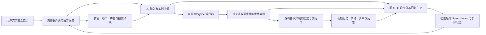

# Lv2 之后：世界线、身体与实时对话首版工程计划

> **2026-10-03 前置修订：Lv2 已由用户按已知风险接受放行，PASS。** 见[ADR-090](../adr/ADR-090-lv2-risk-acceptance-release.md)，M9/M11.1 剩余证据已转后续事项，不再阻断本计划的 Lv2 前置。当前仍沿用通用外部能力建设暂缓、优先 Lv2.5–4.5 的路线；本裁定没有执行后续搭建或重新确认旧工时/日历估算。下文“Lv2 未完成”等前置描述按编制时历史保留。

> 编制：2026-10-02；排期时区：北京时间 UTC+8。工程目标：**2026-10-06 23:59 前完成首版搭建**。
>
> 状态：**设计与排期建议 / 未实施**。本文不宣布 Lv2 已完成，不改变既有失败读数，不批准生产迁移或激活。
>
> 用户已澄清：“结合网页版和 Codex 中的对话”是参考两边已有讨论，形成统一计划。
>
> 本轮仓库核对基线：`main / 55b85523`。工程量为估算，尚未做安装、模型下载或运行探针。

## 0. 2026-10-02 当前路线修订

用户随后明确「我的计划是先不进行能力建设,全力完成Lv2.5-4.5，我需要一份lv2的验收计划书」。当前前置改为[Lv2 人格/认知综合验收与内核交接](../lv2/Lv2-Acceptance-Plan.md)，随后优先推进本计划的世界线、身体、基础语音和持续协调；隔离代码执行/GitHub/微信QQ及其它通用外部能力包暂缓，恢复时机另行裁定。

下文 §1/§2 的旧排期和能力顺序保留为编制时记录，当前以本段为准。“可接入的内核与行动入口”指既有 LG 轮次、合法提案、输入输出和状态读面，不再要求先完成 code.run/GitHub；新增世界/媒体契约仍在本工程 WP0 单独冻结。48–60h 是后续首版工程估算，不含 Lv2 当前缺口，日历须按实际内核交接时间重算。

**2026-10-03 S1 用户修订**：首个世界线确定为 **《一起去参加极创工作室的二面》**；其中真实发生、角色能够感知的共同经历，必须可以进入 LG 既有长期记忆与人格/认知演化链，故事结束后继续影响相处。本修订替代原 S1“剧情只由 Storyline 回放、性格只在阶段内变化”的限制；具体来源、接线和验收见 §5、§9–§11。工程截止仍为 **10/06 23:59**；新增接线工时单列于 §10，旧估算不作为已确认进度。

## 1. 推荐方案与时间前提

建议把 Lv2.5、Lv3、Lv4、Lv4.5 放进一个连续首版工程包：**LG 保持角色和行动权威；inkjs 管理有限故事；Open-LLM-VTuber 提供可替换皮套和语音外壳；补齐流式识别、取消、播放记录与对话仲裁**。

首版收敛为一个“一起参加极创二面”的故事、一套临时 Live2D 皮套、一个流式 ASR 模型、一个 TTS 服务、一个用户。交付可反复演示的完整链路：用户交谈或选择 → 故事推进 → 角色感知、记忆与认知演化 → 表情和声音 → 插话、停止或纠正 → 重启后接着进行，结束故事后仍能追忆共同经历。

估算需要 **48–60 个有效工程小时，另保留约半天故障缓冲**。这是依照集成范围作出的工程判断，不是实测工时。10 月 7 日前完成的关键条件是：**Lv2 至迟在 10 月 3 日上午交出可用且已裁定的内核与行动入口，模型和资源也能及时取得**。越早交接，回归和真实体验验证越充分。

这个日历属于紧凑排期：若从 10/02 下午开始，每天约需 12–15 小时有效工程时间；若到 10/03 上午才开工，则约需 15–18 小时。按单人每天 8 小时安排，48–60 小时加缓冲约为 7–8 个工作日，不能在当前截止前覆盖全部首版。本计划没有隐含增加人员或已经安排后台连续执行；实际资源不足时应调整范围或日期，并保留未完成项。

当前仓库的 [M11.1 阶段判定](../m11.1/M11.1-Gate-Decision.md) 仍为 `IN PROGRESS / NOT PASS`：完整来源生命周期、行为评分、真实混合长链及 M10.1 联调仍有缺口；Lv2 也没有开工或完成裁定。因此，本排期**不包含未完成的人格整合和 Lv2 能力包工时**。如果要求从这个当前状态起，把这些前置工作也全部纳入 10 月 6 日截止，现有证据不足以支持按期保证。

工程完成与各级判定分列。首版必须有运行证据；自然对话质量、语义边界和更长时间稳定性按实测结果判定，失败不得因日期改成通过。

## 2. 已有讨论与仓库依据

以下是本轮实际读取的记录；没有宣称覆盖全部网页版或 Codex 历史。对话表达需求，当前代码和最新判定节表达实现事实。

| 来源 | 直接读取的记录 | 本计划采用的要求 |
|---|---|---|
| 网页版 | [自定义2D3D选项](https://chatgpt.com/c/6ab7f808-f744-83ea-8753-653e63251590)，最近四轮 | 优先审计 Open-LLM-VTuber；关注自定义皮套；语音采用独立服务与适配层；临时成品模型优先于从零制作 |
| 网页版 | [制定实施计划](https://chatgpt.com/c/6ab7cdbb-60fc-83ea-a985-d0f37e730655) | 复用已有认知状态链；模型负责理解与提案，确定性策略和投影保持权威 |
| Codex | `编写 M11 执行计划书`，`01a0f2b7-14cf-72c1-b9ec-62302531ba98`，最近四轮 | 人格与长期一致性先于 Lv2；维护失败读数，补齐真实装配与联调 |
| Codex | `执行 M11.1 计划书`，`01a0fa6c-1101-76e2-a7b3-d0c1f9d29eb4` | 用户选择先完成工程与联调、保留语义 FAIL；没有自动放行 Lv2 的结论 |
| 当前请求 | Lv2.5–Lv4.5 的完整要求及两次澄清 | 有限故事空间；身体输出内部状态；首反馈不超过 10 秒；持续听、想、说、打断和纠正；截止改为 10 月 7 日前 |

已有路线仍按 [M6.5 能力计划](../m6.5/M6.5-Lv2-Capability-Integration-Plan.md)：人格/认知 → Lv2 入口 → 隔离代码执行与 GitHub 闭环 → 微信/QQ 及后续应用波次。本文用 `S1–S4` 表示后 Lv2 工作包，正式 M 系列编号在前置收口后确定，避免占用尚未裁定的 M12 等编号。

必须继承的实现边界：

- [不可变量](../architecture/invariants.md) 与 [未来兼容性](../architecture/future-compatibility.md)：Character 内部事件不能承担 World truth；世界输入不能伪装成用户消息。
- [认知完整性](../architecture/cognitive-integrity.md) 与 [Memory 不可变量](../architecture/memory-invariants.md)：过去、剧情和内部解释都要有合法出处，剧情不能伪造真实用户历史。
- `src/main.ts` 当前在完整模型文本之后执行记忆、动作、外部证据及搜索判定回复守卫，再调用后续记录链。现有代码没有可直接复用的“原始 token 已安全播出”保证。
- `deriveCurrentInput()` 当前拒绝将非对话 Observation 当成用户文本；`WORLD_OBSERVATION` 已登记类型，不代表其生产装配已经存在。
- `scripts/future-compat-tests.ts` 的 FC-T04 仍有“全 src 不存在世界/场景实现”的阶段静态锁。真正建设世界线前，要用新 ADR 将这一阶段锁演进为明确的模块边界测试，继续保留 Character 不写世界事实的负控；不得删锁、改名字绕锁或关闭整道门。
- 真实库只由合法入口持有；前端、Python 语音服务和桥接进程均不打开 PGlite。实验使用 `isolateDatabase()` 与副本，生产迁移依照既有程序另行执行。

## 3. GitHub 方案选择

本轮使用 Exa 从叙事、身体、语音三个方向检索 **49 个请求结果位**，再读取原仓库、官方文档和关键源码。该计数包括重复结果，不代表 49 个独立项目，也不是运行验证。

| 项目 | 直接核对的能力 | 首版使用方式 | 需要补的部分 |
|---|---|---|---|
| [Ink / inkjs](https://github.com/y-lohse/inkjs) | 浏览器和 Node 可用；编译后的故事、当前选项、状态保存/恢复；本轮 master 的 manifest 为 2.4.0 / MIT | **世界线首选**。使用运行器和编译工具，作者定义故事，LG 决定合法输入和认知采信 | 事件来源、版本绑定、可见性、合法选项映射、幂等与事件回放；Ink 本身不提供 LG 的认知边界 |
| [Open-LLM-VTuber](https://github.com/Open-LLM-VTuber/Open-LLM-VTuber) | Python 后端；Live2D 与 ASR/TTS；自定义 Agent 接口；输出可带表情；中断回调与任务取消 | **身体和基本语音首选**。以一个薄 LG Agent 取代默认聊天 Agent，使用其浏览器外壳、模型加载、音频和 TTS 接线 | 当前 AgentFactory 要加显式注册；默认记忆/历史不作 LG 来源；部分识别、播放确认、过期包过滤和取消传递要新增 |
| [sherpa-onnx](https://github.com/k2-fsa/sherpa-onnx) | Windows 支持；在线和离线 ASR；官方 WebSocket 流式服务与中英模型示例 | **Lv4.5 流式 ASR 首选**。复用 OnlineRecognizer 与服务示例，给音频块输出 partial/final | 接入同一音频流，给识别假设编号，接入 LG 的临时处理与最终提交边界 |
| [CosyVoice](https://github.com/QwenAudio/CosyVoice) | 官方 README 提供流式文本/音频生成、中文和情绪/语速指令 | **TTS 首选候选**。使用独立服务和现有音色，输出已检查文本的音频 | Windows/CUDA 或容器运行需首日实测；与 Open-LLM-VTuber 当前适配版本的兼容性不能从 README 推定 |
| [LiveKit Agents JS](https://github.com/livekit/agents-js) | Node 框架、语音服务插件、语义轮次与中断；有 [Node starter](https://github.com/livekit/agent-starter-node) | 实时协调的参考与后备路线 | 增加 WebRTC 服务和客户端整合；框架版本、Python/Node 特性差异、LG 全文守卫要重新适配。首版不同时建设两套语音运行时 |
| [Pipecat](https://github.com/pipecat-ai/pipecat) | Python 音视频管线与丰富 [示例](https://github.com/pipecat-ai/pipecat-examples) | 高级实时管线参考 | 接入既有 LG 的成本和独立运行时管理，使其不进入本次主线 |
| [Project AIRI](https://github.com/moeru-ai/airi) | Web/桌面角色平台，Live2D/VRM、语音及大量相关模块 | 借鉴表现层；以后需要 3D 时重新评估 | 整个平台包含自己的角色、记忆和服务组织，短期移植成本高；没有本轮 LG 接入实测 |
| [pixi-live2d-display](https://github.com/guansss/pixi-live2d-display) / [XState](https://github.com/statelyai/xstate) | 独立 Live2D 渲染 / TypeScript 状态机 | 替代实现与参考 | 首版已有外壳和叙事运行器，不重复增加；渲染库的 Pixi/Cubism 版本必须单独匹配 |
| [FastRTC](https://github.com/gradio-app/fastrtc) | Python WebRTC/WebSocket 和 ReplyOnPause | 快速语音演示备选 | ReplyOnPause 不能独自证明讲话期间已有部分理解、后台检索或完整取消；不当作 Lv4.5 已完成的证据 |

开工 WP0 固定实际采用的 commit/tag、依赖和模型摘要，保存复用登记。库许可证、模型权重许可和皮套资源条款分别记录；Open-LLM-VTuber 的 [LICENSE](https://github.com/Open-LLM-VTuber/Open-LLM-VTuber/blob/main/LICENSE) 明确将示例模型另列在 [LICENSE-Live2D.md](https://github.com/Open-LLM-VTuber/Open-LLM-VTuber/blob/main/LICENSE-Live2D.md)。本轮只确认这些条款需要分别核对，没有替用户选择最终形象。

## 4. 总体接线

协调层负责运输、顺序、临时任务和输出生命周期，不成为第二个人格或事实权威。故事运行器只写所属故事的事实；Character 对故事形成的理解仍走角色自己的合法认知入口。

**单一角色、单一正式历史**：皮套中的 `system_prompt` 不重新定义苏沐薇；Open-LLM-VTuber 默认 `_memory`、历史重载、Mem0、Letta 与 MCP 工具执行不参与 LG 推理。它的本地 UI 历史至多是可丢弃显示缓存。更换皮套、语音服务或重连不能替换 LG 的身份与会话。

生产数据库仍只由 `src/main.ts` 持有。语音桥通过本机受限的命令/事件入口调用**同一套**轮次装配，不能只调用裸模型或独立构造 prompt。聊天/媒体入口与 M5.1 只读 `/dev/query/*` 分开，开发者面继续仅承担原有职责。

首版只实现这次需要的桥接协议和消息，不先建立万能连接器框架。阶段命令、DTO、新事件与下述目录均为建议，WP0 冻结后才成为实现契约。

## 5. S1 / Lv2.5：有限且可持续的世界线

### 5.1 首个故事

首个世界线确定为 **《一起去参加极创工作室的二面》**，后文可简称“极创二面”。起点是：**你已经报名极创工作室、通过一面，现在准备参加二面；你希望与苏沐薇配合，一起通过这次面试。** 你们围绕这个共同目标准备、分工、应对考核并复盘，互动中的支持、误解、更正与合作会成为她之后能够记住的经历。

你的报名、一面通过和协作意愿来自本轮明确陈述。在剧情中，苏沐薇作为你的二面搭档一起参加和配合，核心目标就是“一起通过”。她的现实报名资格、真实二面的时间/地点/题型与考核规则当前尚未提供，不补写为已知事实。首版内容包可以定义明确标注的模拟协作考核规则；若采用真实规则，则按你后续提供的材料落地。模拟结局和现实录取结果分别记录，不以剧情通过宣布现实录取；你后续明确报告的现实结果按用户陈述来源保存。

- 一个故事 ID、一个固定版本；世界范围限于这次极创二面的准备、参加和复盘，约 3 个场景、4 个阶段、12–18 个可达叙事节点。准备地点、二面场景、结果/复盘场景属于内容包，不擅自宣称为极创真实场地。
- 序章引用已有 Seed 背景和你的上述陈述；额外作者前提以 `story-authored` 来源保存，不给真实对话账本补写不存在的往事，也不先写入“她已经陪你参加过一面”。
- 阶段：确认二面目标与信息 → 准备、分工和演练 → 参加二面、合作与应变 → 确认结果、复盘和收束。
- 建议结局：共同通过、结果待定/需要补充考核、本次未通过。达成条件按内容包规则与已提交事件判定；如果真实结果未提供，只能标为模拟结果或待定。明确拒绝/协商退出可以结束本轮，退出不等于被极创判定未通过。
- 分支集中于沟通与配合：如何分工、如何应对不确定题目、遇到失误时是否及时澄清和互相支持。每个结局都要有用户选择和已发生事件的因果链，不因用户一句“我们通过了”跳过考核与结果来源核对。
- 普通交谈可以保持当前阶段，表达拒绝、改变安排或完成合法步骤才触发候选迁移。聊天轮数和现实时间流逝不会自动推进剧情。
- 原定故事没有异世界、超能力或新主线入口；待定不会自动生成无限补考，终局后可以谈二面与已发生的事。另一次招新、三面或其它故事需要新的显式内容包和版本。

### 5.2 四类状态分别保存

| 状态 | 内容与权威 |
|---|---|
| 作者定义 | 世界边界、实体/地点、有限节点、迁移、变量范围、结局；带版本和内容摘要 |
| 已发生故事事实 | 用户合法选择、确定性事件、当前阶段与有限变量；append-only Storyline 事件流为权威，Ink 状态为可重建快照 |
| 角色可见范围 | 她实际感知到的场景和事件；隐藏节点、未选分支和结局条件不能进入角色上下文 |
| 角色认知与表现 | 共同经历经各域合法提案与放行形成长期记忆、信念、关系、情绪及反思/有限行为调整；各域事件为权威，故事运行器不直接覆盖认知状态或 Seed |

最小记录包含 storyId/version、runId、eventId、sourceRef、操作者、期望 revision、实际 revision 和发生时间；认知侧保留相同来源引用、体验范围与对应域事件 ID。现实 recordedAt 与叙事中的阶段/时间分开。重放使用同一故事版本；版本不匹配时明确拒绝，不能默默换剧情。快照重建不再次发送世界观测、写入记忆或重复推动情绪/关系；崩溃后补送仅处理尚未成功消费的事件，各域按来源身份去重。

### 5.3 用户参与与硬边界

按钮可以选择当前合法选项；自然语言理解器只能提议当前 frontier 中的 choiceId 或 `NONE/CLARIFY`。确定性策略重新检查前置条件、当前 revision、权限及幂等后提交。LLM 不能新增地点、节点、人物、变量或结局，不能以任意 `ChoosePathString` 跳过剧情。

只有用户已经确认/提交的选择和程序已经提交的故事事件，才算故事进展。文本里一句“门已经开了”不改变门的状态；用户要求穿越时，角色可以回应，但运行器保持原有世界。

新增世界观测保留独立来源和体验范围，由受控 context section 明确呈现，不能伪装成 `user_message`。实际交谈仍是正式 LG 对话；已提交且她可感知的故事事件成为独立观测。未选分支、作者后台设定、她未见到的事件和模型临时续写，不能当作她亲历的证据。

### 5.4 共同经历进入已有记忆与人格演化

**故事中的经历属于同一个苏沐薇的长期历史。** 接线为：已提交故事事件/真实对话 → 有来源的可见观测 → 记忆与各认知域提案 → 原域放行与事件提交 → 检索、反思和有效状态入模 → 后续交谈与行为。Storyline 回放仍是世界事实依据，LG Memory 是她对经历的持久记忆，两者用来源关联。结束、退出或重启故事不会清空合法认知记录；回到普通聊天时仍可检索和使用这些记录，并说明它们来自哪一次极创二面体验。

| 经历或输入 | 进入的既有链路 | 必须保留的边界 |
|---|---|---|
| 你明确告知“报名极创、通过一面”，或后续更正二面信息 | 用户事实记忆；符合 M9 资格时形成 reported Belief | 保留用户陈述/更正来源；叙述是模拟/假设时保持该范围；不变成官方核验结论 |
| 你们确实进行的分工、演练、互相帮助、失误与复盘 | Memory 的 `episode` / `self_experience` → 正常长期检索 | 来源指向已提交事件及实际互动，带 storyId/version/runId；明确记的是模拟中的经历还是现实对话中的协作 |
| 支持、争执、道歉、更正及合作结果 | 既有 Affect / Relationship 的评价 → 放行 → 事件 → 投影 | 按原域资格、夹紧、更新与失效规则处理；剧情不直接加减情绪或信任数值 |
| 对合作方式的新理解，如“分工没说清容易出错” | 有范围的 Belief 提案、Reflection 候选与证据复核 | 她的解释与已发生事实分别保存；保留反例，不从一次模拟推出你的永久性格或现实能力 |
| 多次有效反馈后，改善澄清、承认更正或推进前核对目标的习惯 | M11/M11.1 的 Reflection → AdaptiveSelf → 后续上下文与行为 | 使用既有三个行为槽与原门槛；单个节点不保证改变，同源重放不增加独立证据数；有效调整可延续到当前角色/用户后续相处 |
| “我们想一起通过二面”及明确的准备约定 | 既有 Goal / Commitment 提案与合法更新 | 共同目标不等于已经通过；约定是否形成承诺按原域识别和准入，不假设缺省关闭的慢路径已启用 |

这里的“影响人格”包含持续的情绪/关系状态、对经历的理解，以及有证据的有限行为习惯变化，**不再限制为本故事阶段内的临时表现**。固定身份和 Seed 保持原有版本纪律；任意重写核心性格/价值观不属于现有自适应能力。既有三个行为槽是 `clarify_when_ambiguous`、`acknowledge_correction_first`、`recheck_goal_before_next_step`，不把信任、依恋等状态误称为这些槽可直接修改的轴。

当前 Memory 的 `EvidenceRef` 已允许 observation/domain_event，但这不证明生产抽取、资格核对、召回和反思根解析已经支持故事来源；M11.1 当前来源链仍以原始对话根为依据。**WP0/WP2 必须追加并验证本故事所需的来源适配**，覆盖事件可见性、体验范围、原始根、去重和失效传播，沿既有放行口接入，不将故事事件复制成用户自述，也不降低现有证据门槛。普通聊天、故事上下文和后续反思中的来源范围必须一致；模拟经历可以持续影响她，但“模拟中通过二面”不能升级成“用户现实中已被极创录取”。

例如，准备时她误解了你的分工，你指出后一起澄清：可以形成一条合作经历记忆，并影响当时的情绪、关系和后续反思。达到原有采纳条件后，她在后续普通聊天推进共同任务时可更主动核对目标。是否真的发生了记忆、调整与行为变化要分别读回和测量，不能以她说“我记住了”或新增一段 prompt 判定完成。

### 5.5 验收

三个候选结局及退出路径都可达；每条路径的用户选择确实改变后续阶段或结果。未知 choice、越界地点、穿越指令、跳阶段、重复投递和过期 revision 均不改变故事，也不产生所请求的虚构进展对应的体验记忆或认知副作用；实际提出请求与明确拒绝的对话仍按正常轮次记录和反应。全图检查不存在未声明主线出口；重启后当前节点、变量、角色可见集合与回放一致。

语义演示需覆盖：普通闲聊、自然语言选择、明确拒绝、来源追问、请求改变世界设定。机械状态没有越界与角色措辞没有编造分别判定；不能用图的有限性证明自然语言永不幻觉。

S1 还必须验证以下持久影响，不能以单条情绪反应替代：

- **长期记忆正控**：一次实际提交、她可感知的共同经历经正式 Memory 链提交；新会话/重启且未加载故事全文时，在普通聊天中能检索追忆，Memory ID 与故事来源读回一致。
- **状态与习惯链**：真实配合事件能触发合法的情绪/关系更新；有足够独立有效反馈的对照场景能完成反思、有限行为调整、实际入模及后续行为测量。未达采纳门槛要明确拒收，不能把单次演练包装成永久成长；程序采纳与行为改善分别判定。
- **来源负控**：未选分支、不可见事件、作者虚构往事与模型续写不形成亲历记忆；模拟结局不成为现实录取事实，来源追问能区分用户陈述、故事体验与她的解释。
- **持久性与失效**：终局/退出不会自动清除合法记忆与调整；重复投递、回放和断点补送不会重复写入或重复累计证据。记忆更正/遗忘、来源撤回按现有语义传播到召回和认知读面，不因 Storyline 回放把失效依据重新灌回；故事重开使用新 runId，旧经历保留原范围。

## 6. S2 / Lv3：身体输出实际状态

复用 Open-LLM-VTuber 的皮套加载与表现层，保留自定义 `.model3.json` 资源目录和模型标识。首版优先拿条款已核对的临时成品/示例皮套验证，不排期自制立绘、rig、3D 或训练专属声音。

直接核对的 [AgentInterface](https://github.com/Open-LLM-VTuber/Open-LLM-VTuber/blob/main/src/open_llm_vtuber/agent/agents/agent_interface.py) 提供 `chat()`、`handle_interrupt(heard_response)`、`set_memory_from_history()`；[输出类型](https://github.com/Open-LLM-VTuber/Open-LLM-VTuber/blob/main/src/open_llm_vtuber/agent/output_types.py) 的 SentenceOutput/AudioOutput 可以附带 expressions。首版桥接 LG 检查后的输出，同时显式注册 AgentFactory；不宣称仅改 LLM base URL 就能继承 LG 全部状态和策略。

| LG 实际状态 | 身体表现 |
|---|---|
| listening | 视线或倾听姿态 |
| 已接收、正在处理 | 思考姿态；它表示处理开始，不表示回答已生成 |
| tool.running | 等待/专注动作，可附真实任务进度 |
| 音频实际播放 | 说话动作和音频驱动口型 |
| 当前有效 Affect | 限定的表情强度与姿态，保留版本来源 |
| interrupted / failed / idle | 停止口型、结束旧动作并进入相应状态 |

任务状态、情绪和嘴型三个来源分别合成。idle 可以随机选择已有待机动作，thinking、speaking 和执行状态必须跟实际事件一致。表情没有对应资源时回到中性，不让缺资源卡住轮次。

验收采用实际 LG 状态触发：至少 6 类任务状态、4 类情绪表现；故障/中断不会继续播放旧嘴型；换皮套后角色 ID、Seed 指纹和故事 revision 不变。断开后重连读取最新状态，旧版本包不得覆盖新状态。

## 7. S3 / Lv4：基本实时语音

基础链路：浏览器麦克风 → VAD/ASR → **最终转录** → LG 正式轮次 → 回复守卫 → 分句 TTS → 音频播放与字幕。部分转录在 S4 中作为临时输入处理。

TTS 采用本机 **Qwen3-TTS 1.7B CustomVoice / Ono_Anna**，中文合成默认使用 `language=Chinese` 与空 `instruct`，后续接线有限的情绪/语速控制。上游的低延迟声明**不能作为 LG 本机延迟证据**。接线探针同时核对中文、冷/热启动、第一段音频、取消和当前桥的输出格式。如果本地 CUDA/依赖阻塞超过约 3 小时，采用开工时已经具备可用权限的 TTS 服务维持主线；并重新测量，记录原定部署未完成。没有可用替代服务时保留阻塞，不假设已有云端凭据。

**2026-10-03 试听修订**：用户试听工程探针采用的 fanchen-unity 后表示“不是很满意”；它不再作为已获认可的交付音色或默认回退推荐。正式音色待选，下一轮比较 CosyVoice 3 0.5B 与 Qwen3-TTS 1.7B CustomVoice（Serena/Vivian），使用相同的普通聊天、二面协作与更正台词，分别判断音色、自然度、情绪表达及首段延迟。两候选尚未在本机合成，不能把上游功能或合成门 PASS 当成用户认可；回退方案也要满足实际音色选择，不能因赶工自动返回不满意的声线。当前工程记录见[依赖与许可冻结](../post-lv2/Post-Lv2-Dependency-and-License-Freeze.md) §2.7。

**2026-10-03 后续选型与实测**：用户确定采用 **Qwen3-TTS 1.7B CustomVoice**。已完成本机模型下载与哈希核对，并用同一句极创二面协作台词合成 Vivian、Serena、Ono_Anna、Sohee 四个女声，均为 24 kHz WAV；具体声线由用户试听后选择。当前 BF16/SDPA、整段生成模式实测合成耗时 **21.98–44.28 秒**，属于离线试听证据，不能当作流式首段出音或浏览器实际播放延迟。S3 接线后仍需按 §7.2 测量，并验证取消与播放对账。详情见[本机试听记录](../post-lv2/Post-Lv2-Qwen3-TTS-Audition-2026-10-03.md)。

**2026-10-03 试听后最终声线**：用户选择 **Ono_Anna**。S3 后续接线采用上述模型与 `speaker=Ono_Anna`；默认中文、自然语气，与用户认可的本机样本一致。声线选择已完成，实时交互与播放验收保持原有标准。

现有 Open-LLM-VTuber ASR [接口](https://github.com/Open-LLM-VTuber/Open-LLM-VTuber/blob/main/src/open_llm_vtuber/asr/asr_interface.py) 返回 `str`；[单轮处理](https://github.com/Open-LLM-VTuber/Open-LLM-VTuber/blob/main/src/open_llm_vtuber/conversations/single_conversation.py) 在准备输入之后调用 Agent。接通这些接口能证明基础语音，不能独自证明 Lv4.5 的持续理解。

**先完成一次 LG 回复检查，再对检查后的文本分句合成。**字幕正文和 TTS 正文采用同一检查后版本；来源附录保留在界面，语音可以只读正文，双方都引用同一个 replyId。早期进度反馈只报告已发生的程序状态。第一版不先播未检查 token，再在字幕里修正已经说出口的成功主张。

### 7.1 延迟测量

| 指标 | 测量点与判据 |
|---|---|
| 输入后的首个可感知反馈 | 浏览器用户提交到实际渲染“已接收/正在处理”或播放起点；**每个受测请求 ≤10 秒**，报告 max 和超标案例 |
| 服务接收确认 | 与浏览器立即显示的本地状态分开；服务拒收/排队/失败都必须如实表示 |
| 有意义语音延迟 | 从用户语音最终提交到第一段实质答复的实际播放；记录 p50/p95/max，首版争取普通短轮 p95 ≤5 秒，必须实测 |
| 检索与复杂任务 | 单独分组，记录真实进度和完整结果时延；不把一句固定占位音算作实质答复 |

Lv4 的 10 秒要求允许处理状态作为反馈；Lv4.5 自然度不能仅用这个数字证明。外部查询可能超过 10 秒，先及时反馈真实状态并继续倾听，完成后再给结果。

正式样本至少 60 次：40 普通请求、10 检索/任务请求、10 冷启动或故障场景。冷启动服务未就绪时就明确展示加载/未就绪；不能假称内核已接收。统计输入类型、模型端点、声卡/浏览器、网络、起止时刻、播放确认和失败；过滤失败样本后再计算“漂亮延迟”不算有效量具。

## 8. S4 / Lv4.5：持续对话协调

本包要真实实现下面六种交互，验证听、想、说和任务确实可以重叠。开放域自由插话的品质、连续多小时和多人环境另做加强评价，不从短演示外推。

### 8.1 边听边处理

复用 sherpa-onnx [官方流式 WebSocket 示例](https://github.com/k2-fsa/sherpa-onnx/blob/master/python-api-examples/streaming_server.py) 与 [OnlineRecognizer](https://github.com/k2-fsa/sherpa-onnx/blob/master/sherpa-onnx/python/sherpa_onnx/online_recognizer.py)。同一麦克风音频流持续供给在线识别，输出带版本的 partial/final；不能把完整录音切几片事后处理后称为流式理解。

partial 期间可开始本地召回、意图候选和响应准备，它们留在临时任务中，不调用会写用户事件/记忆或执行动作的 `beginTurn()`。final 才能走正式用户输入链。确认 partial 稳定也不等于获得记忆写入、故事选择、PR 或发送消息权限。

当用户明确提出并允许“边听边查”时，可以对已稳定、仍属该请求范围的检索对象走既有只读搜索能力；这个出站用法在 WP0 单列策略，继承网络出站与隐私判据。没有该语境就先做本地处理。ASR 修改或话题改变时，取消旧候选；搜索来不及取消的结果也要标成过期，禁止自动入模或落长期记忆。最终采信重新检查请求版本、来源与实际入模范围。

### 8.2 快速信号

首版冻结小集合：停止当前播放、用户更正、呼唤角色。明确“停一下”优先停止声音；呼唤只触发简短回应/倾听，不能代替剧情决策或外部动作。用限定规则、识别置信度和上下文排除引用/否定，覆盖“别停”“他说‘停一下’”“不是叫你”等负控。

### 8.3 用户打断

用户开始有效插话时：本地停止/清空音频和口型 → 增加会话 generation → 通知服务取消当前生成/TTS/检索 → 后续数据核对 generation，丢弃旧包 → 按新输入继续。

原项目的 [中断处理](https://github.com/Open-LLM-VTuber/Open-LLM-VTuber/blob/main/src/open_llm_vtuber/conversations/conversation_handler.py) 有 `task.cancel()` 和 heard_response，但 Python 任务取消不能自动证明远端 LG 请求和用户声卡队列也被取消。首版新增跨桥取消和客户端队列清空，分别验证。

取消的目标是停止过期工作与表达，不撤销已经提交的用户消息、记忆或外部副作用。已开始的外部动作若不能取消，结果仍按原 actionId 记录，不能重新执行，也不能注入新话题。一个会话的正式写入轮次继续串行；“听/准备/播放重叠”不等于两个正式轮次同时写同一库。

### 8.4 角色插话

先交付受限但真实的策略：明确呼唤、紧急停止、更正冲突或用户明确允许边查边提醒时，可在用户尚未结束表达时给一个短提醒，随后让出话权。普通嗯声不自动视为抢话；普通推测不触发强制打断。

插话文本同样经过输出检查。既有 `SpeechIntent` 的记录增加受控的交付元数据或旁路 delivery 事件，不把插话塞成虚假的用户轮次，也不放开全域后台主动发言。开放域“任何时候合理反驳”的品质不作为本版已经解决的主张。

### 8.5 边说边纠正

正在播放时收到新信息或更正：立即停旧段、作废未播段、重新检查证据/上下文 → 生成检查后的纠正段 → 播放。演示必须包括“正在说到一半才收到有效证据”，不能只把原答案播完后补一句。

新证据必须来自合法请求或用户最终输入；模型自己续写出另一种说法不算新的事实来源。不能为原本已失败的动作说“刚才完成了，现在撤销”。

### 8.6 区分生成、提交与实际听见

至少记录 replyId、segmentId、generation、queued/started/finished/cancelled、实际播放区间和 deliveryUnknown。LG 既有完整回复作为生成/提交记录保留；“实际说到哪里”由新增交付记录说明，不能删除或重写已提交历史。

播放确认由客户端上报，是“客户端报告已播放”的证据，不能证明真人确实听懂。断线时状态为 unknown；重连默认不自动重播已提交或未知的句子，以免重复承诺。后续语音上下文据可确认的已播放部分构造，未播出的句子不能被表述为“我刚才已经告诉过你”。

### 8.7 并发验收与延迟目标

六组各至少 5 次：讲话期间本地召回/显式查证、角色短插话、强信号停止、用户打断、证据触发中途纠正、话题改变后的过期结果。另测误触发、否定/引用、回声、断线和重复包。至少一份真实麦克风+真实扬声器/耳机演示能读回事件顺序；fixture 时序不能代替真人体验。

本版建议目标：本地确认有效停止后 250ms 内停播；服务取消/旧包失效 p95 ≤500ms；明确快速信号首反馈 p95 ≤500ms。分别保存声卡实际播放与服务时刻；不靠音频文件生成完成时刻计算“停播”。这些阈值在 WP0 冻结，未测或未达标分别报 NOT RUN/FAIL。

借鉴 [LiveKit 官方轮次/中断文档](https://docs.livekit.io/agents/build/turns/) 的 endpointing、误打断和抢先生成思路，但默认不同时引入 LiveKit。若第一天决定切换整体语音路线，要重新计算工时、冻结同一套权威和交付契约，不能在第四天同时维护两套管线。

## 9. 能力影响矩阵

证据 Layer 1/Layer 2 指用户可见行为和同 ID 读回；它们与能力阶段 Lv1/Lv2 不是同一个概念。

| 工作包 | 复用 / 新增 | 权限与副作用 | 认知/记忆边界 | Layer 1 / Layer 2 |
|---|---|---|---|---|
| WP0 调研/冻结 | 新增运行能力 **NONE** | 文件与只读调研 | 不修改生产角色和真实库 | 依赖探针 / 来源及版本记录 |
| S1 世界线 | inkjs；新增极创二面有限选择、世界观测与认知来源适配 | 合法故事状态写入；共同经历经既有放行口形成持久记忆/认知事件 | 同一角色可持续记住并成长；用户陈述、模拟经历、解释和现实结果保留不同来源；不直接改 Seed 或执行真实应用 | 分支及后续相处有后果 / 故事与 Memory/认知来源、revision、可见性、召回和回放 |
| S2 身体 | 既有状态；新增 avatar 输出 | 本地画面和动画 | 身体不反向修改情绪、Seed 或记忆 | 真状态触发表现 / state version 与表现消息读回 |
| S3 语音 | 既有正式轮次与 SpeechIntent；新增 STT/TTS/播放 | 明确会话中的麦克风、音频输出；服务出站单列 | 最终转录才成用户输入；检查后内容才播出 | 中文收发与首反馈 / 转录、reply、segment 和播放证据 |
| S4 协调 | 既有搜索/任务策略；新增 partial、取消、仲裁、交付记录 | 临时只读准备；明确语境内查证；有限插话 | 无新增外部应用执行权限；取消不撤销事实；过期结果不采信 | 六类真实并发交互 / 同 session、turn、generation、action 的对账 |

新增运行能力要有具名操作和权限映射。语音桥和模型输出中的“动作”标签不能绕过 LG ActionRequest/Policy/Ledger，也不能继承原项目的任意 MCP 执行。既有微信/QQ 入站自动回复与后台不干扰裁定保持在其已配置范围内，本包不扩张渠道或主动发消息范围。

## 10. 工作包与日程

先完成一个工作包的可运行垂直链，再进入下一包；同日可以批量下载/读取独立依赖，但本文没有分派并行代理。估时以单条工程主线为基础。

| WP | 最小交付 | 出口验证 | 工时估算 |
|---|---|---|---|
| WP0 前置与设计 | Lv2 交接；临时资源/许可；依赖探针；世界边界 ADR、故事来源进入 Memory/认知的追加契约、媒体来源/交付/取消契约；锁定版本 | 真依赖可运行；明确新锁/原锁关系；来源适配范围和原域门槛明确；失败阻塞如实记录 | 4–5h |
| WP1 LG 入口桥 | 主进程的受限聊天/事件入口；Python LG Agent；同一轮次装配；身份/会话/正式历史绑定 | 一句文字从外壳走到 LG 并读回；故障不转入默认 Agent | 6–8h |
| WP2 世界线 | 极创二面 Ink 内容；合法 frontier；事件/快照；可见观测/context；长期记忆、情绪/关系与反思/有限行为调整来源接线 | 三结局与退出、越界拒绝；来源准入；普通聊天追忆；合法状态/习惯变化；重启/回放不重复消费；模拟结果不冒充现实 | 12–16h |
| WP3 身体 | 一套皮套；任务/情绪/口型三类状态映射；重连 | 状态驱动；中断即止；换皮套不换人格 | 3–4h |
| WP4 基础语音 | 最终转录正式提交；检查后分句 TTS；字幕、首次反馈和播放记录 | 真中文语音、冷/热启动、超时/故障与 10 秒样本 | 6–8h |
| WP5 持续对话 | 流式 ASR；临时处理；小集合快反；有限插话；取消与版本；中途纠正/交付对账 | 六类重叠交互、旧包负控、未播内容不当成已说 | 13–15h |
| WP6 综合验收 | 量具自证；回归；麦克风演示；安装/启动/停止/恢复说明；分列判定 | 发布命令退出 0、当前源码归属、真实演示及失败表 | 8–10h |

**2026-10-03 S1 修订后的估算合计 52–66h**：WP2 从 8–10h 调整为 12–16h，新增 4–6h 用于故事来源适配、长期记忆/认知接线及持久性验收；其余工作包暂沿用原估算。尚未做运行探针，这不是重新确认按期完成。WP0 若发现需超出既有来源适配的冻结语义变更，应按实际范围重估并报告；不能为赶截止把持续记忆/成长降回显示层效果。下表为原检查点，实际开工日历结合当前交接时间与本次增量更新，目标仍为 10/06 23:59。

| 日期（北京时间） | 当日完成目标 | 最晚检查点 |
|---|---|---|
| 10/02 下午–晚 | 本计划与只读准备；若 Lv2 已交接，执行 WP0、WP1 首句桥接 | 决定实际路线/模型；未交接时不提前部署运行能力 |
| 10/03 | 完成桥接；极创二面可达并存档；共同经历接入记忆/认知；临时皮套显示实际状态 | 当晚检查 LG→故事/记忆/身体闭环及来源适配缺口；据实重估截止 |
| 10/04 | 基础语音与首反馈；流式 ASR 提供持续 partial；播放记录可读回 | 当晚真中文麦克风可用，第一批延迟有读数 |
| 10/05 | 六类持续交互、取消/版本、边说边纠正；完整联合 demo | 当晚代码功能冻结，留下 10/06 做修复与证据 |
| 10/06 | 缺陷修复、发布回归、真实体验、重启恢复、文档和交付 | **23:59 前完成工程状态清单和首版交付** |

### 10.1 保住截止时间的处理

- 第一日模型/CUDA 安装卡住约 3h，就走已可用且许可明确的语音服务；没有可用替代时报告实际阻塞，不承诺无条件过期完成。
- 临时皮套无法满足条款或表情要求时换为已核对的测试资源，不在这几天排期绘制/rig。
- 10/04 晚没有 partial ASR 就判定 Lv4.5 存在排期风险；不能把整段 ASR 加快一点写成“边听边想”。
- 10/05 晚主线仍不通，先交出已经完成的工作包与具体缺口；未完成的 Lv4.5 或世界线保持 PARTIAL，不静默删要求后宣布全工程完成。
- 10/06 不新增故事、第二声线、3D、跨平台渠道、任意自主任务或平台迁移；仅修复与出证据。

## 11. 验收、证据与交接

| 门 | 必须观察到什么 |
|---|---|
| G0 前置/依赖 | Lv2 已有可接入产物及裁定；运行版本、模型、资源、入口和权限明确 |
| G1 故事 | 极创二面有限边界、三结局与退出因果、重复/过期拒收、版本和重启回放一致 |
| G2 来源/认知 | 共同经历经正式链形成长期记忆与合法认知影响；故事结束/重启后的普通聊天可追忆；反思/有限行为调整分列程序与行为读数；用户陈述、模拟、解释与现实结果不混源；未选/不可见事件无亲历写入；回放幂等、失效传播 |
| G3 身体 | 思考/任务/播放/情绪表现可跟真实状态逐项对账；缺资源与重连不会楔死 |
| G4 基础语音 | 中文输入输出实际走 LG；检查后文本与字幕一致；60 次首反馈无超过 10 秒的样本 |
| G5 协调 | 六组重叠交互确实发生；强信号、打断、纠正、旧包与断线有端到端证据 |
| G6 交付真相 | 生成、已提交、排队、已播放、取消、未知明确分列；后续上下文不假装未播段已说 |
| G7 回归/隔离 | 相关模块门、完整离线/真实回归；真实库没有被实验打开或污染；历史证据按纪律保护 |
| G8 体验 | 真人审查二面协作是否能影响进展、她是否持续记得并体现有依据的变化；角色连续性、表情一致、插话恰当与等待感受 |

新量具先跑正控/负控/恢复，要求 measured_count>0。时延使用浏览器/播放端同一时钟，服务端时间只对账，不能直接相减不同机器的时钟。

运行证据建议存 `artifacts/post-lv2/<runId>/`，包含源码/依赖摘要、场景 ID、事件链、revision/generation、统计分母和所有失败。声音/完整转录按已有 local 隐私边界保留，trace/公共证据只存必要引用和测量，不新增隐藏推理日志。

真实副本回归与人工演示分别记录。预录音、fixture 或 mock 通过不能代替真实麦克风、实际皮套、真实 TTS 和合法外部检索的各自读数。

改代码后的最小检查为 `pnpm typecheck` 加受影响模块门。发布必须执行既有 `pnpm m4.5:ci`；跨域接线要补受影响的 m3.5、m4、m4.5、m5.1、相关认知/context 门。真实回归使用 `pnpm with-test-model pnpm m4.5:ci:full` 和本包隔离 smoke。现有约 12.4/34.4 分钟为仓库历史时间，实际新树时间记录到 run；不能用缓存快速档替代发布证据。

最终报告至少分别列：设计、实现、离线机械门、语义/体验、真实链、性能、生产激活。产物须有内容包、桥接代码、版本/许可清单、启动和关闭命令、恢复/回滚说明、验收报告、局限表、演示入口。代码和新文件按明确路径交接/提交，不混入其它会话文件或重写历史证据。

生产激活与工程交付分开：新数据表/迁移只追加当前最新版本之后的版本；真实库启用、世界线内容接纳和资源对外分发依照既有具体载体办理。本文及本次调研没有执行这些操作，也不将当前 M11.1 或 Lv2 缺口销账。

## 12. 本次调研的直接源码索引

- [Ink 运行 API 与保存/恢复](https://github.com/inkle/ink/blob/master/Documentation/RunningYourInk.md)：currentChoices、选择、状态序列化。
- [inkjs package.json](https://github.com/y-lohse/inkjs/blob/master/package.json)：本轮读取的 Node/ESM 导出、候选版本与 MIT。
- [Open-LLM-VTuber AgentInterface](https://github.com/Open-LLM-VTuber/Open-LLM-VTuber/blob/main/src/open_llm_vtuber/agent/agents/agent_interface.py) 与 [AgentFactory](https://github.com/Open-LLM-VTuber/Open-LLM-VTuber/blob/main/src/open_llm_vtuber/agent/agent_factory.py)：薄 Agent 的实际接入点。
- [SentenceOutput / AudioOutput / Actions](https://github.com/Open-LLM-VTuber/Open-LLM-VTuber/blob/main/src/open_llm_vtuber/agent/output_types.py)：文本、音频和表情输出形状。
- [ASRInterface](https://github.com/Open-LLM-VTuber/Open-LLM-VTuber/blob/main/src/open_llm_vtuber/asr/asr_interface.py)、[WebSocket 处理](https://github.com/Open-LLM-VTuber/Open-LLM-VTuber/blob/main/src/open_llm_vtuber/websocket_handler.py)、[single_conversation](https://github.com/Open-LLM-VTuber/Open-LLM-VTuber/blob/main/src/open_llm_vtuber/conversations/single_conversation.py)：当前整段输入与输出管线。
- [conversation_handler](https://github.com/Open-LLM-VTuber/Open-LLM-VTuber/blob/main/src/open_llm_vtuber/conversations/conversation_handler.py)：取消与 heard_response；不足以单独证明 LG 及客户端也停播。
- [自定义 Live2D 模型指南](https://github.com/Open-LLM-VTuber/open-llm-vtuber.github.io/blob/main/docs/user-guide/live2d.md)：资源目录、model_dict、表情映射；文档与实际 frontend 版本要在开工时匹配，不混用不同版本的 Cubism/Pixi 说明。
- [sherpa-onnx streaming_server](https://github.com/k2-fsa/sherpa-onnx/blob/master/python-api-examples/streaming_server.py)：连续音频输入的已有服务基础。
- [CosyVoice 官方 README](https://github.com/QwenAudio/CosyVoice/blob/main/README.md)：流式和表达指令；本机性能尚未验证。
- [LiveKit 轮次与中断](https://docs.livekit.io/agents/build/turns/) 与 [Node basic_agent](https://github.com/livekit/agents-js/blob/main/examples/src/basic_agent.ts)：参考架构；不同语言/版本功能不可混同。

网页记录读取有工具截断，本文采用了可见内容与实际用户请求；没有将截断后的建议当成已批准的资源、硬件事实或生产授权。全部上游能力是源码/文档核对，LG 本机可用性与延迟需 WP0 及后续运行证据确认。
