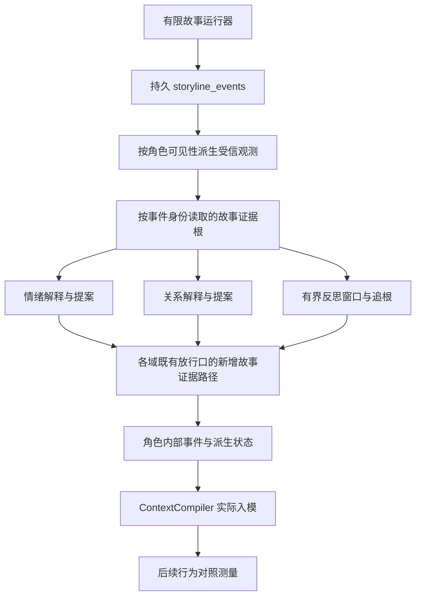

# S8 状态与习惯链：现成方案调研与最小接线建议

日期：2026-10-03（北京时间）。状态：**调研与工程建议 / 未实施**。
本机核对基线：`1f8011662f52652e36869428919df858d21b98e1`。
范围：寻找能处理非对话经历、影响情绪/关系、形成有依据的有限行为调整的现成实现。

## 1. 结论

**S8 的故事经历链目前属于实现缺失、已推迟建设。** 原计划表的 `NOT RUN` 只表达未测量，不能据此理解为“工程已经具备，只等真模型验证”。
[ADR-092](../adr/ADR-092-pl2-sr-01-story-durable-root-ruling.md) D03 与 `L-PL2-02` 已明确记录：故事事件表、根解析、评估器新输入面、迁移与冻结面回归未做。
本报告补充工程方案，不改写该 ADR 或历史门的读数。

**现成实现可以复用部分组件；本次没有找到能直接接入 LG、同时满足来源边界与 S8 全部判据的一站式方案。**
最合适的首版是：保留 LG 的 M7/M8/M11 状态与采纳主干，参考 Concordia 的世界观测输入链，按需采用 FAtiMA/Ensemble 的评价规则，参考 ExpeL 的成功/失败对照方法。
持久根、来源资格、提案接线、幂等和失效传播仍需在 LG 内实现。

使用 [Exa Search](https://exa.ai/) 从世界观测、情绪/社会评价、状态编排、经验学习四个方向进行 8 次检索，合计 70 条结果槽位（含重复与淘汰结果）；再读取关键仓库、官方文档和固定提交源码。
以下“已核对”指源码与元数据核对，**没有运行候选引擎、安装依赖或验证其在本机的端到端效果**。

## 2. 本机缺口比“扩一个类型”更大

| 位置 | 当前实现 | S8 必须补的东西 |
|---|---|---|
| [processor.ts](../../src/kernel/contracts/processor.ts) | `ProcessorEventView.id` 是 `ConversationEventId`，事件类型/actor 仅覆盖对话 | 独立的故事观测输入视图，保持旧对话输入语义 |
| [affect/evaluator.ts](../../src/kernel/app/affect/evaluator.ts)、[relationship/evaluator.ts](../../src/kernel/app/relationship/evaluator.ts) | 主动筛选合格 `user_message`；情绪还要求 active user、cutover | 各域明确的故事经历资格与解释规则；仅放宽 union 仍会被过滤 |
| [affect.ts](../../src/kernel/contracts/affect.ts)、[relationship.ts](../../src/kernel/contracts/relationship.ts) | 放行判据再次要求真实、合格对话证据 | 追加具名的故事证据放行路径；不能只改评估器后绕过 validator |
| [proposal.ts](../../src/kernel/contracts/proposal.ts)、[domain-event.ts](../../src/kernel/contracts/domain-event.ts) | 因果引用是 `sourceConversationEventIds` | 追加版本化、带 kind 的故事来源引用，保留旧字段语义；角色事件只描述内部变化 |
| [reflection/inputs.ts](../../src/kernel/app/reflection/inputs.ts) | 从领域触发事件及其引用的对话构造窗口 | 可见、已提交故事来源的取数口与有界输入；确定性的触发入口 |
| [reflection-input.ts](../../src/kernel/contracts/reflection-input.ts) | 触发来自已登记领域事实；`user_feedback` 在 v1 无检测器、不可达 | 登记故事结果/有效反馈的触发契约；不能凭空伪造 `GOAL_COMPLETED` 来触发 |
| [reflection-lineage.ts](../../src/kernel/contracts/reflection-lineage.ts)、[reflection/lineage.ts](../../src/kernel/app/reflection/lineage.ts) | handle 四类；原始根最终是对话；来源标签五类、没有故事体验 | 新根类别、故事来源标签、按真实事件身份去重、归属/可见性/失效读取 |
| [qualification-read.ts](../../src/infrastructure/persistence/qualification-read.ts)、[reflection-lineage-read.ts](../../src/infrastructure/persistence/reflection-lineage-read.ts) | 根查询按 `evidence_kind = 'conversation_event'` 过滤 | 新 kind 的精确 ID 解析；存在性与认知资格分别判定 |
| [reflection/inputs.ts](../../src/kernel/app/reflection/inputs.ts) 的稳定门槛 | 至少 3 个有效根、2 个会话、无未解决冲突 | 明确故事根如何参与既有门槛；不能把两个 `runId` 自动算成两个合格会话 |
| [migrations.ts](../../src/infrastructure/persistence/migrations.ts) | 没有 `storyline_events` 持久表 | 追加新迁移、持久账本与重启消费；不修改已发布迁移 |

S8 原判据见[故事世界来源契约 §2](../post-lv2/Post-Lv2-Story-World-Source-Contract.md)：合法状态更新、足够独立有效反馈、反思、有限调整、实际入模、后续 A/B/C 行为测量，未达门槛明确拒收。
episode 能被保存/召回，不能替代上面这条状态与习惯链。

## 3. GitHub 候选：能省哪部分代码

| 候选 | 已核对的现成能力 | 语言 / 许可证 | 对 LG 的建议 |
|---|---|---|---|
| [Google DeepMind Concordia](https://github.com/google-deepmind/concordia) | 外部 `observe()` → 组件处理 → 观测记忆 → 自我/情境反思 → 行动上下文 | Python / Apache-2.0 | **整体输入链的第一参考**；组件可在隔离试验中复用，首版不替换 LG 人格与认知权威 |
| [FAtiMA Toolkit](https://github.com/GAIPS/FAtiMA-Toolkit) | 世界事件感知、自传体事件记录、情绪 appraisal、社会重要性、情绪驱动决策 | C#、`netstandard2.0` / Apache-2.0 | **现成情绪评价核心的第一候选**；采用原引擎需 .NET 包装与状态映射，只向 LG 提交待审解释/提案 |
| [Ensemble Engine](https://github.com/ensemble-engine/ensemble) | 社会事实、时间步历史、触发规则、行动意愿与动作效果 | JavaScript / 四条款 BSD 文本，GitHub SPDX 为 `NOASSERTION` | **关系与社会规则的第一参考**；可试验复用纯规则部分，不能让其可变社会状态成为 LG 的第二份权威状态 |
| [ExpeL](https://github.com/LeapLabTHU/ExpeL) | 成功/失败轨迹对照、提取经验规则、增删改规则、后续任务使用经验 | Python / Apache-2.0 | **习惯学习与行为对照的参考**；已有 M11 采纳纪律继续生效，不照搬自动更新规则 |
| [XState](https://github.com/statelyai/xstate) | 类型化外部事件、状态转换、持久快照接口、纯转换 API | TypeScript / MIT | 可直接复用状态编排；LG 已有状态机/事件折叠，首版先复用本仓库，避免增加重复层 |
| [StanfordHCI/genagents](https://github.com/StanfordHCI/genagents) | 任意观测 `remember(content)`、`reflect(anchor)`、JSON 保存/加载 | Python / MIT | 小型观测/反思探针的备选；没有 LG 的情绪/关系资格与行为采纳链 |
| [AI Town](https://github.com/a16z-infra/ai-town) | TypeScript 世界循环、异步 agent、对话记忆、带关联记忆的反思 | TypeScript / MIT | 参考队列和异步处理；所查记忆入口仍是 `rememberConversation()`，不能直接补非对话经历输入 |

排序依据是与 LG 缺口的对应程度、既有权威边界、语言与部署成本、可追溯能力，不按 star 数排序。
以上复用程度是**工程判断**，不是上游提供的 LG 兼容性承诺。

### 3.1 Concordia：最接近“世界经历进入认知”

固定源码：[EntityAgent.observe](https://github.com/google-deepmind/concordia/blob/b71d202750e23444ce1bf28d9f114bcd88aa41db/concordia/agents/entity_agent.py#L188) 接收观测字符串，依次执行 `pre_observe`、`post_observe`、`update`；
[ObservationToMemory](https://github.com/google-deepmind/concordia/blob/b71d202750e23444ce1bf28d9f114bcd88aa41db/concordia/components/agent/observation.py#L30) 把观测加入记忆；
[QuestionOfRecentMemories](https://github.com/google-deepmind/concordia/blob/b71d202750e23444ce1bf28d9f114bcd88aa41db/concordia/components/agent/question_of_recent_memories.py#L120) 根据近期记忆与其他组件生成反思性上下文。

可借用的是**对话之外的观测入口及组件分工**。输入是普通字符串，不能由此获得 LG 所需的受信事件身份、证据独立性或撤回传播。
上游 GM 可以用模型裁定世界事件；LG 的有限 Ink 世界已有“只选合法 choice”的边界，首版继续保留本地确定性故事运行器。
上游内容与角色组件接入时只提供候选解释，角色状态仍由 LG 放行口裁定。

### 3.2 FAtiMA：确实有世界事件到情绪的代码

固定源码：[RolePlayerCharacterAsset.Perceive](https://github.com/GAIPS/FAtiMA-Toolkit/blob/56b7cbd992f953cfe21a7b12cb1a0e6cdf6ccf9f/Assets/RolePlayCharacter/RolePlayerCharacterAsset.cs#L314) 感知事件；
[EmotionalAppraisalAsset.AppraiseEvents](https://github.com/GAIPS/FAtiMA-Toolkit/blob/56b7cbd992f953cfe21a7b12cb1a0e6cdf6ccf9f/Assets/EmotionalAppraisal/EmotionalAppraisalAsset.cs#L94) 记录事件，处理属性变化，形成 appraisal 并更新情绪；角色还有 `Decide()` 与情绪衰减 `Update()`。
模块目标框架见[csproj](https://github.com/GAIPS/FAtiMA-Toolkit/blob/56b7cbd992f953cfe21a7b12cb1a0e6cdf6ccf9f/Assets/RolePlayCharacter/RolePlayCharacter.csproj)。

如果希望少写 appraisal 算法，可在隔离进程中复用它；输入限于 LG 已验证的可见观测，输出转换成 LG 待审提案。
FAtiMA 会维护自己的知识与情绪，必须处理它与 LG 状态的一致性；不能直接把它的状态当成 M8 canonical state。
其情绪分类/强度和 LG 的情绪状态不等价，映射需要独立验证。社会重要性也不能直接当成 LG 的关系信任值。

### 3.3 Ensemble：已有 JavaScript 社会规则引擎

固定源码：[ensemble.js](https://github.com/ensemble-engine/ensemble/blob/8b74bdec4ba2ef4e14795b7591df3b5d73f283e3/ensemble/ensemble.js#L994) 导出 `set`、`runTriggerRules`、`calculateVolition`、`getActions`、`doAction`；
[socialRecord.js](https://github.com/ensemble-engine/ensemble/blob/8b74bdec4ba2ef4e14795b7591df3b5d73f283e3/ensemble/socialRecord.js#L6) 使用内存数组与时间步历史。
配有 Lovers and Rivals 的 schema、trigger、volition 与 action 内容示例。

适合借用“事件事实 → 规则命中 → 社会评价/动作意愿”的设计或规则组件。
它没有 LG 所需的数据库事务、事件来源资格、不可见事件隔离和失效传播，不能把内存历史视为持久账本。
源码[许可证](https://github.com/ensemble-engine/ensemble/blob/8b74bdec4ba2ef4e14795b7591df3b5d73f283e3/LICENSE.md) 含广告署名条款，不能当成 MIT/BSD-3 处理；目前按研究参考对待，实际分发前确认对应条款。

### 3.4 ExpeL：最贴近“经验改善后续处置”

固定源码：[agent/expel.py](https://github.com/LeapLabTHU/ExpeL/blob/e41ec9a24823e7b560c561ab191441b56d9bcefc/agent/expel.py#L124) 对照成功与失败轨迹生成 critique；
同文件的 [`create_rules`](https://github.com/LeapLabTHU/ExpeL/blob/e41ec9a24823e7b560c561ab191441b56d9bcefc/agent/expel.py#L287) 解析规则操作并更新规则集合。

可用于设计 S8 的反思材料与留出场景评估，不能替代程序追根和有限采纳。
“模型写出一条经验”不等于“足够独立有效反馈形成习惯”；LG 仍由程序计算根数、检查反例、审查有限槽位，模型不能自报证据数量。
[Reflexion](https://github.com/noahshinn/reflexion) 同样可参考反馈到下一次尝试的循环；其任务重试框架没有补上 LG 的故事来源或情绪/关系接口。

### 3.5 XState 与 AI Town：需要区分基础设施和 S8

XState 的[持久化文档](https://stately.ai/docs/persistence) 提供快照保存/恢复与事件重放示例，但持久存储由应用提供。
其[纯 transition API](https://github.com/statelyai/xstate/blob/fbee62e7c1586315ed478c2fedf530d7e0ff5a3e/packages/core/src/transition.ts#L21) 返回下一快照及待执行动作，适合避免重放时重复副作用。
它不提供故事证据解析、情绪解释或习惯采纳策略。

AI Town 的[记忆源码](https://github.com/a16z-infra/ai-town/blob/8e05997f2409275669c8344b84a51692e83f3f33/convex/agent/memory.ts#L24) 从结束的对话构造记忆，再触发反思。
反思存储有 `relatedMemoryIds`，但触发阈值是记忆重要性累计，不能替代 LG 的独立根与跨会话门槛。
把 TypeScript AI Town 接进来，仍需为故事观测新增来源面，且会引入 Convex 世界/记忆后端；因此不是首版主方案。

## 4. 推荐接法：复用本仓库主干，追加来源链

图为**目标链路 / 未实施**。情绪、关系、反思按各自条件消费经历；不要求每条事件先更新所有状态。

1. **持久世界事实**：在 ADR-091 允许的 `src/infrastructure/storyline/store/` 中追加故事事件仓储，复用现有 PGlite 与迁移框架。沿用已有 `story:<storyId>@v<version>#<runId>.<eventId>` 身份；快照可由事件重建。
2. **受信观测输入**：由真实已提交事件、可见集合、内容版本与参与者绑定派生视图。模型只看到受控窗口和 handle，不负责声明“这件事真实发生了”。
3. **追加来源种类与引用**：新故事证据 kind、各域提案的引用、lineage 读面、归属和失效解析一起增加。旧 `sourceConversationEventIds` 继续只指对话；角色事件登记内部解释/状态变化及故事来源引用，不取得世界事实的写入权威。
4. **扩各域受理路径**：情绪按体验解释；关系只评价有真实参与者依据的互动；反思需新的确定性触发、故事来源标签与原始根解析。优先沿用本仓库算法和有限行为槽位。
5. **可靠消费与失效**：按稳定事件身份消费；重启可补扫，重复投递不二次更新。持久记录已经受理的解释/提案结果，重放状态不重新调用模型或发副作用。来源失效时沿既有失效链阻断上下文与依赖采纳。
6. **入模与行为验证**：沿现有 ContextCompiler、adaptive-self section 与事实包读取；必须记录实际入模的 revision，并在未加载故事全文的后续场景测量行为。

外部组件的边界是**候选解释/评价策略**：只消费受信观测，只产待审提案；不会成为世界、人格或长期认知的另一份权威。
这比整体引入第二个 agent 框架更符合当前源码：LG 的状态、反思、有限采纳与入模层已有实现，缺的是新的受控来源通路。

## 5. 实施前需要冻结的三项语义

以下是新工程包必须解决的问题，不在本轮静默改门槛。

| 问题 | 建议边界 |
|---|---|
| 什么可改变情绪/关系？ | 故事结局可成为体验解释依据；关系必须绑定真正参与者及其实际选择。NPC/作者预设的夸奖不能当成真实用户行为，不能改变“她对用户”的关系 |
| 什么算独立反馈？ | 同一故事事件派生出的观测、Memory、Reflection 共用同一根身份，只计一次；重放/转述不增加根；更换 `runId` 不自动证明反馈独立 |
| “2 个会话”怎样适用于故事？ | 第一版可只累计实际有受信互动绑定的真实会话；纯故事观测无法满足时如实拒收。若要采用经历阶段/episode 作为新分组轴，需显式修订采纳契约，不把 `runId` 偷换成 `conversationId` |

故事根被持久解析，不会因此取得现实事实资格。`STORY_OBSERVATION` 仍不能支持“现实中已经录取”等结论。
Seed 不参与这条习惯调整；行为变化继续受既有有限槽位与范围约束。

## 6. 可以立项的工程包及验收

| 工程包 | 具体产物 | 验收条件 |
|---|---|---|
| WP0：来源与采纳契约 | 新 ADR/契约，覆盖根类别、参与者、反馈、分组轴、触发及版本化引用 | 正控、负控、恢复三段量具；旧对话资格不变；能明确拒收不达门槛材料 |
| WP1：故事持久账本 | 追加迁移、受控写入、精确 ID 读取、重放与补扫 | 真子进程重启；字段级一致；未提交/不可见/错版本事件不能成为根 |
| WP2：根与提案来源接线 | Memory 资格读面、Reflection lineage、各域来源引用与失效读取 | 原始根数大于 0；同事件多条派生链只计一次；悬空/跨角色/失效来源拒收 |
| WP3：三个评估域 | 故事输入、资格规则、validator、新触发与 job 消费 | 实际故事事件分别进入合适评估域；正控有合法更新，负控无越权更新；重投/补扫不重复累计 |
| WP4：有限调整实际入模 | 复用 M11 的采纳/槽位/ContextCompiler | 门槛不足明确拒收；满足后合法采纳；引用的 slot/revision 在实际入模集合里；失效后不再注入 |
| WP5：后续行为 | 预先冻结的 A/B/C 对照场景与真模型读数 | A=没有采纳调整，B=有有效采纳调整，C=依据失效后；相同条件、留出场景、盲评与诚实失败读数 |

WP0–WP4 的工程门与 WP5 的行为结果分别报告。离线验证成功不能宣布形成习惯。
测试先在隔离库/生产副本进行；正式接线之后再按改动面跑 typecheck、Memory/Kernel、M7/M8/M11 和来源边界回归，以及完整 `m4.5:ci` 与适用真实链路门。
本轮只建立调研文档，未执行这些工程包或测试。

## 7. 能力影响

| 面 | 本次调研 | 后续 S8 接线的影响 |
|---|---|---|
| 外部应用/桌面/MCP 权限 | `NONE` | 方案不需要新增通用外部控制入口 |
| 模型运行与出站 | `NONE` | 复用既有 provider 的反思调用；新触发与调用量需写入工程契约，不凭本报告启用 |
| 世界存储与迁移 | `NONE` | 追加故事持久账本；真实库迁移仍按独立授权执行 |
| 长期认知 | `NONE` | 新故事来源受理属 Cognitive Integrity 审查范围；模型输出只作为提案 |
| 生产激活 | `NONE` | 本报告不改变开关、生产状态或任何历史验收结果 |

## 8. 上游核对快照

以下为 2026-10-03 读取的默认分支提交；日期是提交时间的 UTC 日期，不是兼容性或维护质量保证。

| 仓库 | 固定提交 | 提交日期 | 元数据/源码许可 |
|---|---|---|---|
| [Concordia](https://github.com/google-deepmind/concordia/tree/b71d202750e23444ce1bf28d9f114bcd88aa41db) | `b71d202750e23444ce1bf28d9f114bcd88aa41db` | 2026-10-01 | Apache-2.0 |
| [FAtiMA](https://github.com/GAIPS/FAtiMA-Toolkit/tree/56b7cbd992f953cfe21a7b12cb1a0e6cdf6ccf9f) | `56b7cbd992f953cfe21a7b12cb1a0e6cdf6ccf9f` | 2024-05-31 | Apache-2.0 |
| [Ensemble](https://github.com/ensemble-engine/ensemble/tree/8b74bdec4ba2ef4e14795b7591df3b5d73f283e3) | `8b74bdec4ba2ef4e14795b7591df3b5d73f283e3` | 2019-12-17 | `LICENSE.md` 四条款 BSD 文本；API `NOASSERTION` |
| [ExpeL](https://github.com/LeapLabTHU/ExpeL/tree/e41ec9a24823e7b560c561ab191441b56d9bcefc) | `e41ec9a24823e7b560c561ab191441b56d9bcefc` | 2024-12-20 | Apache-2.0 |
| [XState](https://github.com/statelyai/xstate/tree/fbee62e7c1586315ed478c2fedf530d7e0ff5a3e) | `fbee62e7c1586315ed478c2fedf530d7e0ff5a3e` | 2026-09-15 | MIT |
| [genagents](https://github.com/StanfordHCI/genagents/tree/96854071ef4c2d79c93144c973c7820722d52bab) | `96854071ef4c2d79c93144c973c7820722d52bab` | 2024-11-18 | MIT |
| [AI Town](https://github.com/a16z-infra/ai-town/tree/8e05997f2409275669c8344b84a51692e83f3f33) | `8e05997f2409275669c8344b84a51692e83f3f33` | 2026-08-26 | MIT |
| [Reflexion](https://github.com/noahshinn/reflexion/tree/218cf0ef1df84b05ce379dd4a8e47f17766733a0) | `218cf0ef1df84b05ce379dd4a8e47f17766733a0` | 2025-01-14 | MIT |

Ensemble 的默认分支提交较旧，FAtiMA/genagents/ExpeL 的所查提交也并非近期；优先看经过验证的可抽取接口，不以演示成功推定 Node 22/Windows/LG 兼容。
进入实施时，先对准备实际复用的组件做固定版本的本地接口、重启与许可证探针，再决定是否引入生产依赖。
